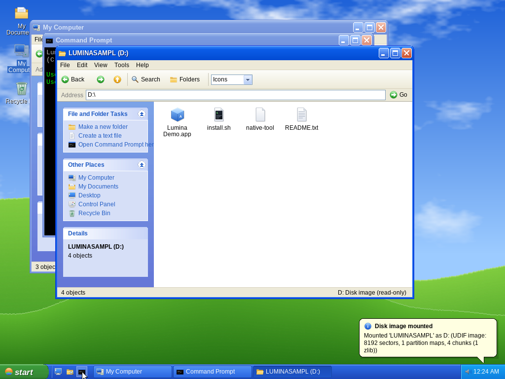

# Lumina OS

An original 32-bit x86 operating system written from scratch in C and assembly, with an
XP-style "Luna" desktop, a Windows 7-style Control Panel, and compatibility layers that run
**Win32 `.exe` programs**, **`.sh` shell scripts** and **Apple `.dmg` disk images**.

It boots on real PC hardware or in QEMU/VirtualBox from a GRUB ISO, into a boot screen,
a welcome/log-on screen and then the desktop.

| | |
|---|---|
|  |  |
|  |  |
|  |  |
|  |  |

## Build and run

Requirements (Ubuntu/Debian): `gcc` (with `-m32`), `nasm`, `make`, `grub-pc-bin`, `grub-common`,
`xorriso`, `mtools`, `qemu-system-x86`. Optional: `gcc-mingw-w64-i686` (to rebuild the sample
`.exe` files), `dosfstools` + `python3` (to rebuild `Sample.dmg`), Pillow (to regenerate assets).

```bash
make            # builds build/lumina.elf and lumina.iso
```

```bash
make run        # boots the ISO in QEMU (256 MB RAM, std VGA, serial log on stdout)
```

GRUB offers three entries: normal boot, **verbose boot** (kernel log on the boot screen),
and **safe mode** (Classic theme).

Other targets: `make samples` (rebuild the Win32 samples with mingw-w64), `make dmg`
(rebuild `rootfs/Samples/Sample.dmg`), `make assets` (regenerate fonts/icons).
`tools/qemu_harness.py` drives a headless QEMU over QMP (mouse, keyboard, screenshots).

## What's inside

### Kernel (`src/kernel`)
- Multiboot entry, GDT (with a per-thread FS segment for the Win32 TEB), IDT, remapped PIC,
  exception handling (a faulting program is terminated with an error dialog; kernel faults
  show a stop screen).
- 4 MiB-page paging; each Win32 process gets **its own page directory** mapping its image
  window (4–16 MiB), so several programs can load at the same base address.
- Heap allocator, cooperative multitasking scheduler (tasks, sleep, kill, exit codes,
  CPU/idle accounting), PIT timer (1 kHz), CMOS RTC, PS/2 keyboard and wheel mouse,
  PCI enumeration, CPUID, PC speaker, ACPI/Bochs power-off and keyboard-controller reboot,
  serial (COM1) kernel log.
- In-memory VFS with drive letters, populated from a tar initrd; read-only FAT12/16/32
  driver with long file names; DEFLATE/zlib decompressor; UDIF `.dmg` parser.

### Desktop (`src/gui`)
- Double-buffered framebuffer renderer (1024×768×32), anti-aliased fonts (Liberation, SIL OFL),
  63 original procedurally drawn icons (48/32/16 px), five procedural wallpapers.
- Window manager: Luna title bars with rounded corners and caption buttons, move/resize,
  maximize/minimize, double-click title, system menu, menu bars, popup menus, modal dialogs,
  Alt+Tab, Alt+F4, Win key, Ctrl+Shift+Esc.
- Taskbar with Start button, Quick Launch, task buttons and clock; two-column Luna Start menu
  with All Programs flyout; Classic cascading Start menu with vertical banner; tray balloons;
  desktop icons with context menus; boot screen; welcome screen; Turn Off / Log Off dialogs
  over a desaturated desktop.
- **Visual styles:** Luna (Blue), Olive Green, Silver and Windows Classic. A **hue slider
  (0–359°)** recolours title bars, frames, taskbar, Start menu, selections and buttons of any
  style (also `theme olive 40` from the shell).

### Applications (`src/apps`)
File Explorer (task pane, Icons/Tiles/Details, history, copy/cut/paste, rename, Recycle Bin,
eject), Notepad (selection, clipboard, word wrap, Open/Save dialog), Command Prompt,
**Control Panel in Windows 7 style** (Category / Large icons / Small icons, breadcrumb bar,
search, navigation pane; Personalization, Display, Taskbar, Date and Time, System,
Device Manager, Network, Mouse, Keyboard, Sound, Programs and Features, Default Programs,
User Accounts, Fonts, Ease of Access), Task Manager (applications, processes, CPU/memory
graphs), Calculator, Paint (BMP open/save), Image Viewer, Snake, Properties, Run, About.

### Compatibility
- **`.exe` — Win32 subsystem (`src/win32`)**: PE32 loader (sections, base relocations, import
  binding, TLS callbacks, TEB/PEB), implementations of ~190 kernel32, ~190 msvcrt, ~160 user32,
  ~40 gdi32 functions plus advapi32/shell32 basics. Console programs get stdin/stdout through
  the terminal; GUI programs get real windows, message queues, timers, BUTTON/STATIC/EDIT/
  LISTBOX controls, menus, MessageBox and GDI drawing. The included samples are ordinary
  programs compiled with `i686-w64-mingw32-gcc` and run unmodified. Unimplemented imports are
  reported by name instead of crashing.
- **`.sh` — shell (`src/shell/sh.c`)**: tokenizer + recursive-descent parser to an AST;
  variables, `${…}` operators, `$(…)`, backticks, `$((…))`, globbing, pipes, `>`, `>>`, `<`,
  `2>&1`, `&&`/`||`, `if/elif/else`, `while/until`, `for`, `case`, functions, and ~70 builtins
  (`ls grep sort wc head tail find tree cp mv rm mkdir read printf test seq ps kill mount
  hdiutil open theme …`).
- **`.dmg` — Apple disk images**: `koly` trailer, XML plist `blkx` table, `mish` chunk maps
  (raw, zero-fill, zlib/UDZO), MBR/GPT partition maps, then the FAT volume is mounted as a new
  drive. `.app` bundles are launched via `Info.plist` → `CFBundleExecutable`; script
  executables run in the shell.

## Honest limits
- 32-bit only: **64-bit (x64) `.exe` files, .NET assemblies and 16-bit DOS programs are
  detected and refused** with an explanation. Win32 coverage is a subset — programs using
  unimplemented APIs (COM, DirectX, dialog resources, networking, …) stop with a message
  naming the missing function.
- macOS cannot be emulated: **native Mach-O binaries inside a `.dmg` are identified but not
  executed**; only script-based bundles run. HFS+/APFS volumes and bzip2/LZFSE/LZMA-compressed
  images are detected and reported as unsupported (FAT volumes with raw/zlib chunks work).
- Storage is a RAM disk (changes are lost on reboot); no network stack, no USB, no sound
  card beyond the PC speaker, fixed 1024×768 resolution, single CPU, cooperative (not
  preemptive) scheduling, programs run in ring 0.
- "Luna", "Olive Green", "Silver" and "Classic" describe the visual styles this project
  recreates; all artwork, icons, wallpapers and the logo are original.

## Layout
```
src/kernel   boot, cpu, drivers, memory, scheduler, VFS, FAT, inflate, DMG
src/gui      graphics, themes, window manager, widgets, desktop shell, screens
src/apps     explorer, notepad, terminal, control panel, accessories, launcher
src/shell    sh interpreter
src/win32    PE loader, kernel32, msvcrt, user32/gdi32
samples/     Win32 sample sources (hello.c, winhello.c)
dmgroot/     contents of Sample.dmg
rootfs/      initrd contents (C:\)
tools/       asset generator, DMG builder, QEMU test harness
```
