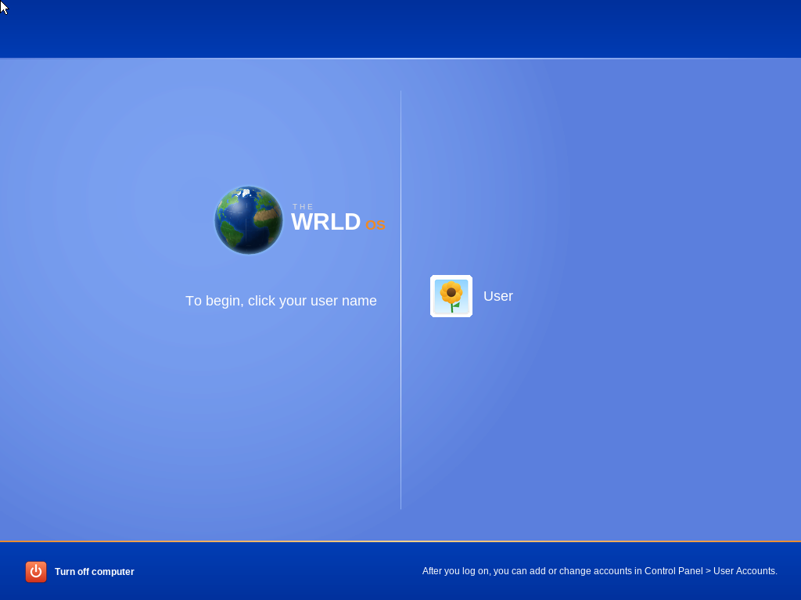
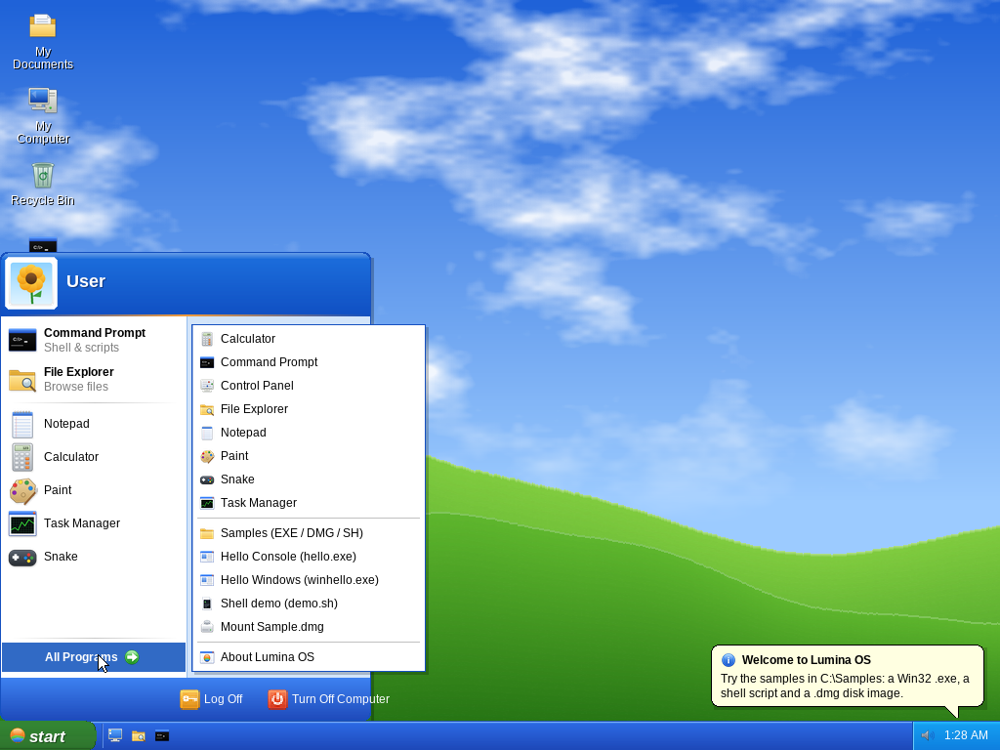
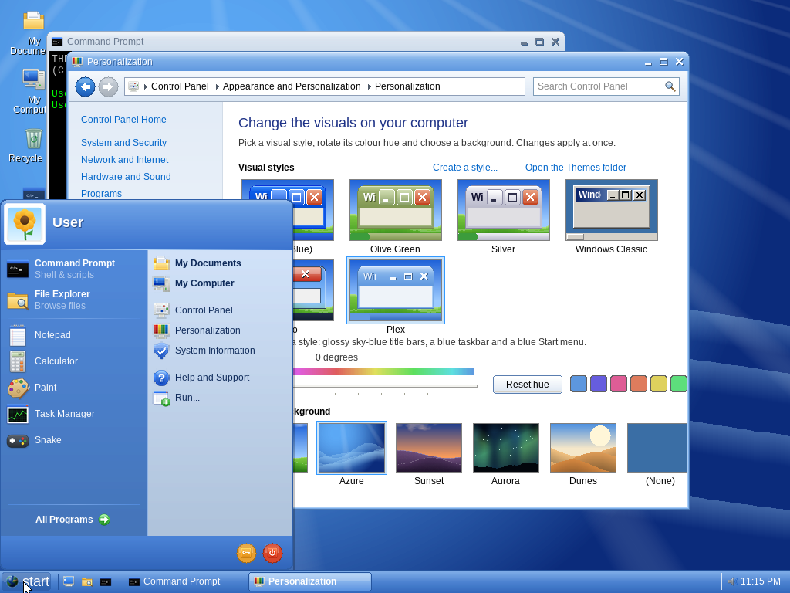
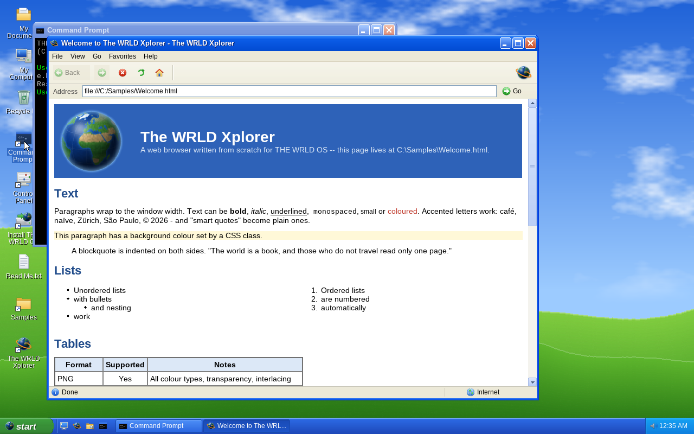
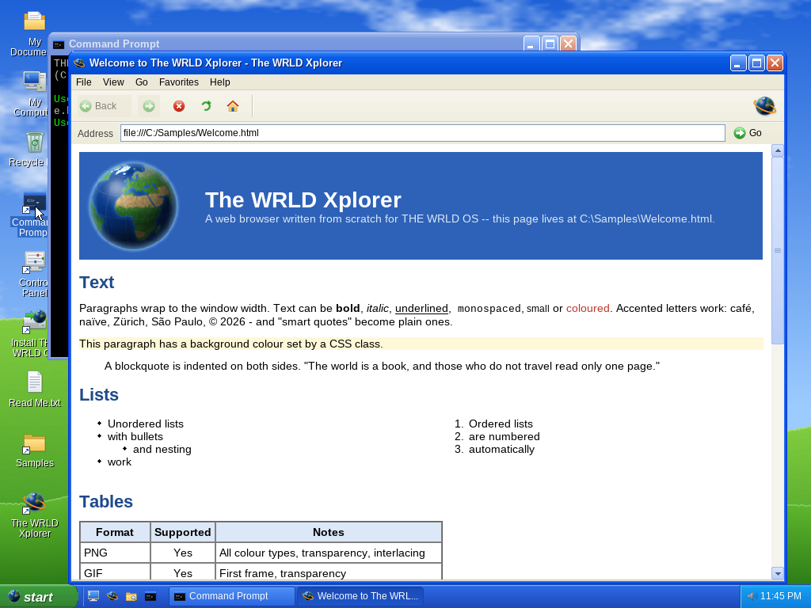
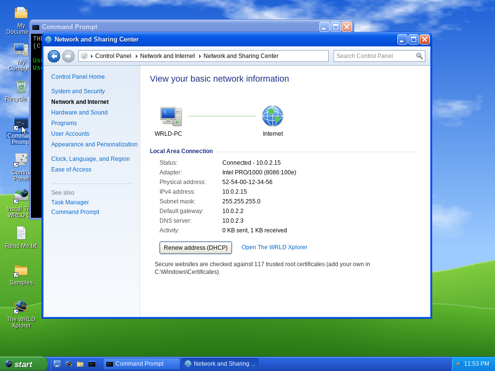
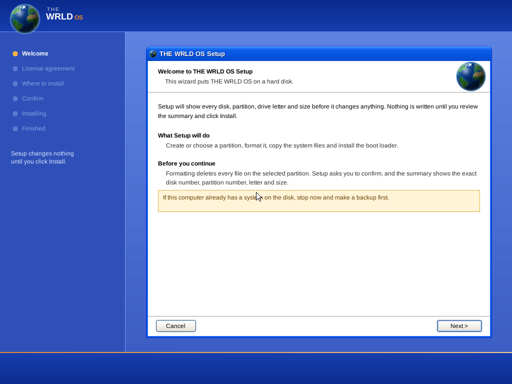
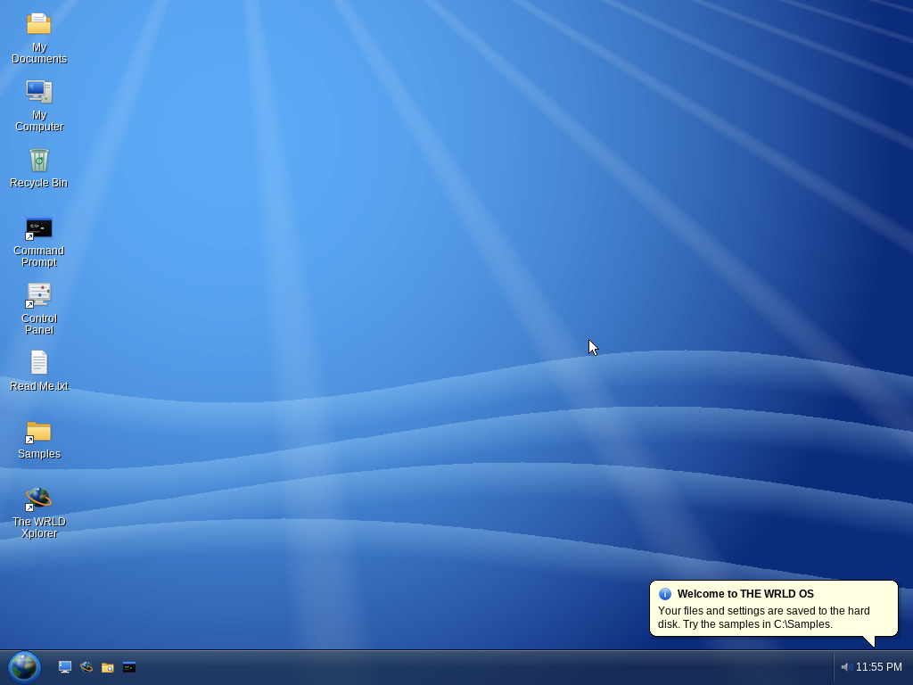

# THE WRLD OS

An original x86 operating system written from scratch in C and assembly (about 20,000
lines, plus the Mbed TLS library for HTTPS, the QuickJS JavaScript engine and the Lexbor HTML parser), in a **32-bit**
and a **64-bit (x86-64) edition**. It has an XP-style "Luna" desktop and a
category-style Control Panel, and it runs **Win32 `.exe` programs**, **`.sh` shell scripts** and opens
**Apple `.dmg` disk images**. It connects to the network and has its own web browser,
**XplorerLite**.

- Boots from a GRUB CD image (BIOS or UEFI) into a spinning-globe boot screen, a log-on
  screen and the desktop.
- **Two editions from the same sources:** `wrldos.iso` (32-bit, i686) runs 32-bit Win32
  programs; `wrldos64.iso` (64-bit, x86-64 long mode) runs 64-bit (x64) Win32 programs.
  Everything else is the same.
- Runs **live from the CD** or **installs to a hard disk** with an XP-style Setup, after which
  every file and setting is saved to the disk.
- Visual styles **Luna (Blue), Olive Green, Silver, WRLD Classic, Aero** (translucent
  blurred glass) and **Plex** (Longhorn-style). Each one is a `.wrldstyle` text file you can edit
  or copy, and each can be recoloured with **hue, saturation and lightness** sliders.
- **Networking:** drivers for Intel (PRO/1000, e1000e, I217-I219, I210/I211/I350), Realtek
  (RTL8111/8168/8125, RTL8139), AMD PCnet, VMware VMXNET3 and virtio-net cards, a TCP/IP stack
  with DHCP and DNS, and HTTPS with certificate checking.
- **Real power-off** through ACPI, on VirtualBox, VMware, Hyper-V and real PCs as well as QEMU.
- **Sound:** drivers for Intel HD Audio, AC'97 (Intel, nVidia, AMD, SiS), Ensoniq AudioPCI
  (ES1370, ES1371/ES1373) and Sound Blaster 16. A startup sound plays when you log on and a
  shutdown sound plays before the computer turns off.
- **Graphics:** drivers for the Bochs/QEMU, VirtualBox and VMware display adapters, so the
  resolution can be changed at runtime (1024×768 up to 1920×1200 or more).
- **Text:** scalable TrueType fonts (Liberation Sans and Mono, read from `C:\WRLD\Fonts`) with
  OpenType shaping: Arabic (with its joining forms and mark positioning, in Noto Naskh Arabic),
  Hebrew, ligatures, and the Unicode bidirectional algorithm, so right-to-left text mixes with
  Latin and numbers correctly — at any size.


| | |
|---|---|
|  |  |
|  |  |
|  |  |
|  |  |
|  |  |
|  |  |
|  |  |

### XplorerLite

| | |
|---|---|
|  |  |
|  |  |

### Installing to a hard disk

| | |
|---|---|
|  |  |
|  |  |
|  |  |
|  |  |
|  |  |

## Quick start

### Windows: one double-click

Double-click **`Build to ISO.bat`** in the source folder. It:

1. builds through **WSL** (Windows Subsystem for Linux), or through **Docker Desktop** if WSL
   is not set up;
2. installs the Linux build tools on the first run (Ubuntu may ask for your Linux password);
3. writes **`wrldos.iso`** (32-bit edition) and **`wrldos64.iso`** (64-bit edition) next to
   the .bat file.

If neither WSL nor Docker is available, it explains why and offers to install WSL with Ubuntu.
After that you restart Windows, open *Ubuntu* once to create a Linux user, and run the .bat
again.

> MSYS2, MinGW and Cygwin cannot build the kernel. Their `gcc` makes Windows PE files, not the
> ELF kernel that GRUB loads, and they have no BIOS GRUB tools. `make` stops with an
> explanation if you try. The .bat file uses WSL for exactly this reason.

### Linux (or a WSL terminal)

```bash
sudo apt install build-essential gcc-multilib nasm grub-pc-bin grub-efi-amd64-bin grub-common xorriso mtools qemu-system-x86
```

```bash
make            # the 32-bit edition: build/wrld.elf and wrldos.iso
```

```bash
make ARCH=x86_64    # the 64-bit edition: build64/wrld.elf and wrldos64.iso (or "make both")
```

```bash
make run        # boots the CD in QEMU: live session, nothing is saved
```

`make ARCH=x86_64 run` (and `run-install`, `run-disk`) does the same with the 64-bit edition
in `qemu-system-x86_64`; its hard disk image is `disk64.img`.

Tested with Ubuntu 22.04 (gcc 11, binutils 2.38, GRUB 2.06) and 24.04 (gcc 13, binutils
2.42). `make check-tools` lists any missing tool. Fedora's `grub2-*` tool names are detected
automatically. On WSL, clone the repository inside the Linux file system (for example
`~/XPLikeTest`, not `/mnt/c/...`). On Windows 11 the QEMU window opens on the normal desktop.

## Running and installing

### In QEMU

| Command | What it does |
|---|---|
| `make run` | Live session from the CD. Nothing is saved. Networking uses QEMU's built-in NAT, and sound goes to PulseAudio/PipeWire when it's running (also under WSLg). |
| `make run-install` | CD plus a blank 512 MB `disk.img`. Choose **Install THE WRLD OS**. |
| `make run-disk` | Boots the installed `disk.img` on its own, with no CD. |
| `make disk` | Creates the blank `disk.img` (size: `make disk DISK_MB=1024`). |

You can also choose the emulated hardware:

- `make run SOUND=ac97` (or `ich9`, `es1370`, `sb16`) picks another emulated sound card
  instead of HD Audio.
- `make run VGA=vmware` uses the VMware SVGA II display adapter.
- `make run AUDIO=alsa` (or `sdl`, or `none`) picks QEMU's host sound output.

### In VirtualBox, VMware or on a real PC

Boot `wrldos.iso` (or `wrldos64.iso`, in a VM set up for a 64-bit guest, for example
VirtualBox's "Other/Unknown (64-bit)") with **legacy BIOS** or **UEFI** boot and at least
**64 MB RAM** (both editions start in 48 MB; 256 MB is comfortable for the browser). The ISO
is a hybrid image: a PC-BIOS core and an x86-64 EFI System Partition (`EFI/BOOT/BOOTX64.EFI`).
UEFI firmware must be 64-bit (the usual kind); a 32-bit-only EFI machine cannot boot it. To install,
attach a hard disk on any of the usual controllers: **IDE**, **SATA (AHCI)**, **NVMe**, or **SCSI**
(VMware/VirtualBox **LSI Logic** and **LSI Logic SAS**, **VMware Paravirtual**, **virtio-scsi**), a
**virtio-blk** disk in QEMU/KVM/Proxmox, or a **USB** disk behind a UHCI, OHCI, EHCI or xHCI
controller.
USB keyboards and mice work the same way, including through a hub. BusLogic adapters are not supported.
For sound, any of the cards VirtualBox offers works (**Intel HD Audio**, **ICH AC97** or
**SoundBlaster 16**), and VMware's **HD Audio** or **Ensoniq AudioPCI** (ES1371). Graphics work with **VBoxVGA**, **VMSVGA** or
VMware's SVGA, and those can change resolution. Every network adapter VMware offers works (**e1000**, **e1000e**,
**VMXNET3**, and the **AMD PCnet** "vlance" it picks for Windows XP guests), as do VirtualBox's (**Intel PRO/1000**,
**PCnet**, **virtio-net**) and QEMU's e1000, e1000e, igb, rtl8139, pcnet, vmxnet3 and virtio-net.

While an installed system starts, the boot screen shows what it is doing, including
"Loading files from the hard disk… N%". If it stops on one step, that step names the device
involved. It also warns when the machine has less than 64 MB of memory.

If the desktop ever stops responding while the clock still runs, a red banner at the top of the
screen names the task that is busy (the same line goes to the serial log). Please include it
when you report the problem.

### The CD boot menu

| Entry | |
|---|---|
| **Boot THE WRLD OS from the hard disk** | Shown, and selected by default, once the system is installed. |
| **THE WRLD OS Live** | Runs from the CD in RAM (default when nothing is installed). |
| **Install THE WRLD OS** | Starts Setup. |
| Live (verbose boot) | Shows the kernel log on the boot screen. |
| Live (safe mode) | Starts with the WRLD Classic style. |

The installed system has its own boot menu with the same normal, verbose and safe-mode entries.

If the firmware never delivers the 8259's timer interrupt, the kernel notices within the first
few milliseconds and switches to the local APIC timer by itself, so the clock, the boot
animation and every timeout keep working. Adding `lapic` to a kernel command line forces that
timer, which is useful when testing a machine that boots with a silent timer.

### What Setup does

You can also start Setup from the **Install THE WRLD OS** icon on the live desktop.

1. **Text-mode Setup** (blue screens, keyboard-driven, like XP's):
   - welcome screen and licence (F8 to agree);
   - **partition list**, where you can create (C) and delete (D) partitions;
   - **format** as NTFS or FAT32, quick or full, or keep the existing file system. When Setup
     was started by UEFI firmware the system partition must be FAT32: it becomes the EFI System
     Partition (type `0xEF`) and receives `\EFI\BOOT\BOOTX64.EFI`;
   - **copies the system** and writes the boot loader: GRUB's boot code in the MBR and its core
     image after the MBR (which also keeps the disk BIOS-bootable);
   - restarts.
2. **First boot from the disk**: a graphical wizard asks for:
   - time zone;
   - your name and organisation;
   - computer name;
   - visual style and account picture.

   It then finishes with *Finalizing installation*.
3. From then on, changes to `C:` are written back to the disk: new folders, deletes and
   renames immediately, file contents within about 2 seconds and at shutdown/restart.
   Settings (theme, hue, wallpaper, account picture, user and computer name, time zone, mouse
   and clock options) are kept in `C:\WRLD\wrld.ini`. Control Panel > System and About show
   which disk and partition the system runs from, and how much space is free.

## Using THE WRLD OS

- **Samples** in `C:\Samples`:
  - `hello.exe`, a Win32 console program;
  - `winhello.exe`, a Win32 GUI program;
  - `demo.sh`, a shell script;
  - `Sample.dmg`, a disk image with a `.app` bundle and an installer script.
- **XplorerLite** (Start menu > Internet, or the globe on Quick Launch):
  - It runs **JavaScript** (QuickJS) and has a built-in **ad blocker**. Try
    `C:\Samples\JavaScript demo.html` (linked from the home page).
  - The home page links to sites that work well, such as Wikipedia, Hacker News, CNN Lite and
    68k.news.
  - It has DuckDuckGo search; you can also type words in the address bar to search.
  - `C:\Samples\Welcome.html` shows everything it can render.
- **Command Prompt** examples:
  - `ipconfig`, `ping example.com`, `nslookup example.com`;
  - `wget https://example.com/file.zip` downloads a file; `curl URL` prints it;
  - `theme list`, `theme aero`, `theme plex 200`, `theme saturation -40`, `theme lightness 20`;
  - `js -e "[1,2,3].map(x => x * x)"` or `js script.js` runs JavaScript;
  - `open control personalization` opens Control Panel at Personalization;
  - `open C:/Samples/Sample.dmg` mounts the disk image;
  - `hdiutil info` shows mounted images;
  - `sync` writes pending changes to the disk now (installed systems);
  - `display` lists screen resolutions, and `display 1280x800` switches to one;
  - `volume 60`, `volume mute`; `play "C:/WRLD/Media/WRLD Startup.wav"`;
  - `hostname`, `ps`, `free`, `shutdown -r`;
  - `help` lists all commands.
- **Keyboard**:
  - Win key opens the Start menu;
  - Alt+Tab switches windows and Alt+F4 closes them;
  - Ctrl+Shift+Esc opens Task Manager.

## What's inside

### 32-bit and 64-bit (`src/arch/i686`, `src/arch/x86_64`)
- One set of C sources builds both editions; only the boot stub, the interrupt and
  context-switch assembly and the linker script are per architecture.
- **x86-64:** GRUB loads the 64-bit ELF kernel through Multiboot 2 (or Multiboot 1 on an older
  GRUB). A 32-bit stub checks for long mode, identity-maps the first 4 GiB with 2 MiB pages,
  enables PAE, long mode, the FPU and SSE, and calls the same `kmain`. Interrupt stubs save the
  SSE state (`FXSAVE`), so drivers and the JavaScript engine can use SSE; the cooperative
  context switch keeps the callee-saved registers.
- Win32 programs get their own address space: on x64 a private PML4/PDPT, with the image
  mapped at its preferred base (usually `0x140000000`) in 2 MiB pages, so no relocation is
  needed.

### Kernel (`src/kernel`)
- **CPU and interrupts:**
  - Multiboot 1 **and** Multiboot 2 headers with a 1024x768x32 framebuffer request. A small
    boot-information layer (`bootinfo.c`) normalises memory maps, modules, command lines and
    the framebuffer; on UEFI, Multiboot 2 also supplies the ACPI RSDP and marks the firmware
    as EFI.
  - x86: GDT with a per-thread FS segment for the Win32 TEB; x64: the TEB through the GS base
    MSR. IDT and remapped PIC.
  - Exception handling: a faulting program is closed with an error dialog; kernel faults show
    a stop screen.
- **Memory:**
  - 4 MiB-page paging. Each Win32 process gets **its own page directory** for its image window
    (4–16 MiB), so several programs can load at the same base address.
  - Heap allocator.
- **Scheduling:** cooperative multitasking (tasks, sleep, kill, exit codes, CPU/idle
  accounting).
- **Devices:**
  - PIT timer (1 kHz), CMOS RTC, PS/2 keyboard and wheel mouse.
  - **Display (`video.c`):**
    - Bochs/BGA "DISPI" driver for QEMU's standard VGA, Bochs and VirtualBox VBoxVGA.
    - VMware SVGA II driver (command FIFO) for VMware and VirtualBox VMSVGA.
    - Resolution changes at runtime from Control Panel > Display, with an XP-style "keep these
      settings?" countdown, and are saved in `wrld.ini`.
  - **Sound (`audio.c`):**
    - **Intel HD Audio:** CORB/RIRB codec commands, and a search for the output path from the
      DAC to the speaker or headphone pins.
    - **AC'97:** bus-master DMA, for Intel ICH and the compatible nVidia nForce, AMD and SiS
      controllers.
    - **Ensoniq AudioPCI:** ES1370 (AK4531 codec) and ES1371/ES1373/CT5880 (AC'97 codec and
      the sample rate converter); DAC2 loops over the ring.
    - **Sound Blaster 16:** DSP 4.x, 16-bit stereo auto-init ISA DMA from a buffer below
      16 MiB; the 8237 count register gives the position.
    - Output is 48 kHz 16-bit stereo (44.1 kHz on the ES1370 and Sound Blaster 16), fed by a
      ring of DMA buffers refilled from the timer interrupt.
    - A 4-voice mixer with volume and mute, and a WAV loader for 8/16/24-bit PCM at any sample
      rate and channel count.
  - PCI enumeration, CPUID, PC speaker.
  - ACPI power management: reads the FADT and the DSDT's `\_S5_` soft-off value, so power-off
    works on any ACPI machine; restart uses the ACPI reset register, then port 0xCF9, then the
    keyboard controller.
  - Serial (COM1) kernel log.
- **Storage:**
  - Disk controllers behind one block-device layer (`blk.c`), all polled and found by a PCI scan
    of every bus (VMware puts NVMe and SAS controllers behind bridges):
    - IDE/ATA (`ata.c`): bus-master DMA with a PIO fallback, LBA28/LBA48.
    - SATA AHCI (`ahci.c`): Intel ICH/PCH, QEMU q35, VirtualBox and VMware SATA; BIOS hand-off.
    - NVMe (`nvme.c`): admin + one I/O queue pair, PRP lists, every namespace, 512-byte or 4 KB blocks.
    - SCSI (`scsi.c`): INQUIRY / REPORT LUNS discovery, READ CAPACITY(10/16), READ/WRITE(10/16),
      SYNCHRONIZE CACHE, over these host adapters:
      - LSI Logic Fusion-MPT (`mpt.c`): 53C1030 and SAS1064/1068, i.e. VMware's and VirtualBox's
        "LSI Logic" and "LSI Logic SAS" (doorbell handshake, request/reply FIFOs).
      - VMware Paravirtual SCSI (`pvscsi.c`).
      - virtio-scsi (`virtio.c`).
    - virtio-blk (`virtio.c`). Both virtio drivers handle the virtio 1.0 and the legacy PCI transport.
    - Disks with 4 KB sectors are read and written with read-modify-write of partial blocks.
  - MBR partition tables.
  - **Read/write FAT32** driver: format, long file names, create/replace, recursive delete,
    rename/move, in-memory FAT with write-back.
  - **Read/write NTFS** driver (`ntfs.c`), written from scratch for NTFS 3.1:
    - Format: boot sector and its backup, `$MFT` and `$MFTMirr`, an empty `$LogFile`,
      `$Volume`, `$AttrDef`, `$Bitmap`, `$Boot`, `$BadClus`, `$Secure`, `$UpCase`, `$Extend`.
    - 1 KB MFT records and 4 KB index blocks with update-sequence fixups; resident and
      non-resident attributes with run lists; files keep `$STANDARD_INFORMATION`,
      `$FILE_NAME` (Win32 names), a security descriptor and `$DATA`.
    - Folders are `$I30` B-tree indexes (`$INDEX_ROOT`, `$INDEX_ALLOCATION`, `$BITMAP`),
      rebuilt as a balanced tree when they change.
    - Create/replace, mkdir, rename/move, recursive delete, read; GRUB boots from it through
      its `ntfs` module.
    - Volumes it creates pass `ntfsfix`, and `ntfs-3g` lists and reads every file.
  - `vol.c` puts FAT32 and NTFS behind one interface for Setup and persistence.
  - Read-only FAT12/16/32 reader for disk images.
  - DEFLATE/zlib decompressor and UDIF `.dmg` parser.
- **Files:** in-memory VFS with drive letters, filled from a tar initrd (live CD) or from the
  system partition (installed). `persist.c` writes changes back to the disk and keeps the
  settings file.

### Linux programs (`src/linux`, 64-bit edition)
The first step towards running WPE WebKit as The WRLD Xplorer: unmodified x86-64 Linux
programs run in ring 3 and call the kernel with Linux's system call numbers.
- **Address space:** programs live above 512 GiB, so the kernel's identity map of the low
  4 GiB stays untouched; pages are allocated on first touch (`uvm.c`, `pmm.c`).
- **Loading:** position-independent executables (the default on current distributions) and
  the dynamic loader they name, with a Linux start-up stack (argv, environment, auxv) (`proc.c`).
- **Files:** `/` is `C:\Linux`, `/mnt/c` is `C:\`, `/lib`, `/bin` and so on follow the merged
  `/usr` layout, and `/dev/null`, `/dev/zero`, `/dev/urandom`, `/dev/tty` and `/proc/self/exe`
  are built in (`fs.c`).
- **System calls:** files, directories, mmap/brk/mprotect, time, thread-local storage, futexes,
  identity and limits (`syscall.c`); kernel code stays cooperative, and a program running in
  ring 3 is preempted by the timer.
- Type the program's path in the Command Prompt, for example
  `C:/Linux/usr/bin/hello` or `C:/Linux/usr/local/bin/signals`. The 64-bit ISO carries test
  programs from `samples/linux` (`hello`, `threads`, `ipc`, `procs`, `signals`, `socket`); they are
  built against **musl** as static PIE when `musl-gcc` is installed, so nothing else is needed, or
  against the build machine's glibc (copied in) when only gcc is available.
- Threads: `clone()` with the flags glibc's `pthread_create` uses (new TLS, child TID cleared
  and woken on exit), so mutexes, condition variables and `pthread_join` work.
- **Processes:** `fork`, `vfork` and `execve` (a new image and start-up stack in the same pid),
  and `wait4` with `WNOHANG`, so a shell can start a program, wait for it and collect its exit
  status. `getppid` reports the real parent.
- **Pipes:** `pipe` and `pipe2` over a 64 KiB ring buffer, with `O_NONBLOCK` and EOF when the
  last writer closes.
- **Sockets (`ipc.c`):** `AF_UNIX` stream, datagram and seqpacket sockets, `socketpair`,
  `bind`/`connect`/`listen`/`accept`, `sendmsg`/`recvmsg` with `SCM_RIGHTS` descriptor passing.
- **Network sockets:** `AF_INET` TCP and UDP over the kernel stack in `src/net`, with
  `send`/`recv`/`sendto`/`recvfrom`, `getsockname`/`getpeername`, `getsockopt`/`setsockopt`
  (`SO_REUSEADDR`, `SO_ERROR`, `SO_TYPE`, buffers, `TCP_NODELAY`) and non-blocking mode.
  `getaddrinfo` works through the distribution's glibc: `/etc/hosts`, `/etc/host.conf`,
  `/etc/nsswitch.conf`, `/etc/resolv.conf` (from the DHCP lease) and `/etc/services` are created
  in the RAM file system on first lookup.
- **Event loop:** `epoll_create1`/`epoll_ctl`/`epoll_wait`, `eventfd` and `timerfd`, and `poll()`
  now asks each pipe, socket, eventfd and timerfd whether it is ready instead of answering
  "always ready".
- **Signals (`signal.c`):** POSIX dispositions per process, pending sets per process and per
  thread, and a real x86-64 `rt_sigframe` (a `ucontext` with 23 registers and a 128-byte
  `siginfo`) handed to a handler in ring 3, so glibc's `__restore_rt` and `rt_sigreturn` work
  unchanged. `sigaltstack`, `SA_RESTART`, `SA_NODEFER`, `SA_RESETHAND`, `SA_SIGINFO`,
  `sigsuspend`, `sigpending`, `sigtimedwait`, `alarm`/`setitimer`, `SIGCHLD` from a child that
  ends, `SIGPIPE` from a pipe or socket with no reader, and dispatch of `SIGSEGV`/`SIGFPE`/
  `SIGILL`/`SIGBUS`/`SIGTRAP` to a handler installed for them. `kill`, `tkill` and `tgkill`
  deliver to a whole process or to one thread.
- Not yet: job control (`SIGSTOP`/`SIGCONT`, `WUNTRACED`), `signalfd`, IPv6 sockets and a
  loopback interface, and a real `vfork` (it does not suspend the parent). See `ROADMAP.md` for
  the rest of the way to WPE WebKit.

### USB (`src/usb`)
- **Host controllers:** all four kinds a PC uses. **xHCI** (`xhci.c`, USB 3.x, what every
  machine has had for the last decade), **EHCI** (`ehci.c`, USB 2.0 high speed),
  **UHCI** (`uhci.c`, USB 1.1 on PIIX/ICH chipsets) and **OHCI** (`ohci.c`, USB 1.1 on
  non-Intel chipsets and add-in cards). They are all driven by polling: xHCI through command,
  event and per-endpoint TRB rings; EHCI through queue heads and qTDs on the asynchronous and
  periodic schedules; UHCI through a frame list of queue heads and transfer descriptors; OHCI
  through endpoint descriptor queues on its control, bulk and periodic lists. Every controller
  found is enumerated, and several can be active at once.
- **Enumeration:** port reset and enable, `GET_DESCRIPTOR`, `SET_ADDRESS` (on xHCI the address
  lives in the slot context), full configuration parsing (interfaces and endpoints) and
  `SET_CONFIGURATION`, plus one level of **hub**: the hub's ports are powered and reset and the
  devices behind them enumerated too, with the xHCI route string filled in.
- **HID** (`hid.c`): every HID interface of a device becomes its own keyboard or mouse, so a
  keyboard with a media-key interface, or a wireless receiver that carries both a keyboard and a
  mouse, works. The report descriptor is read to find the buttons, X, Y and wheel (any width,
  with or without a report ID), and a mouse is read in that format; a keyboard uses the boot
  protocol, or its descriptor (a key array or an N-key rollover bitmap) when it has no boot
  interface. Absolute pointers (tablets) are not driven. Reports are translated to PS/2 set 1
  scancodes and packet deltas, so the existing keyboard and mouse code (modifiers, Caps Lock,
  speed, button swap) works unchanged; a held key repeats in software, because a USB keyboard
  does not repeat by itself.
- **Mass storage:** bulk-only transport with CBW/CSW and the SCSI commands `INQUIRY`,
  `READ CAPACITY(10)`, `READ(10)`, `WRITE(10)` and `SYNCHRONIZE CACHE(10)`. The disk registers in
  the block layer like any other, so Setup and the volume code see it as a normal disk.
- Tested in QEMU with each controller: `qemu-xhci`, `usb-ehci`, `piix3-usb-uhci` and
  `pci-ohci`, with a USB keyboard, mouse and disk. One script (log on with a mouse click, open
  Command Prompt from the taskbar, type a line and edit it with the arrow, Home, End and Delete
  keys) gives the same screen with USB devices on each of the four, and behind a hub on xHCI, as
  it does with PS/2. Mice with a report ID, 16-bit or packed 12-bit axes, N-key rollover
  keyboards and multi-interface devices are checked against the descriptor parser on the build
  machine (`make check-hid`), since QEMU has no such devices. A USB disk reads and writes
  sectors back unchanged. With more than one controller in the same machine, each enumerates
  its own devices. EHCI handles high-speed devices itself and hands full/low-speed ports to the
  companion; it does not implement split transactions, so a full-speed device behind a
  high-speed hub is not seen, and isochronous transfers and hotplug after boot are not
  implemented.
- If no USB keyboard or mouse is enumerated, or one is found but never sends a report, the log-on
  screen names every controller it found, the devices it enumerated and the last failures, so a
  machine with a dead port or a stuck endpoint can report what is actually there.

### Networking (`src/net`)
- **Network cards** (all polled; the first one found is used):
  - Intel PRO/1000 8254x, 8257x (VMware's e1000e is an 82574L), ICH8-10/PCH and I217/I218/I219 (`e1000.c`).
  - Intel 82575/82576/I350/I210/I211 (`igb.c`), with advanced descriptors.
  - Realtek RTL8111/8168, RTL8169, RTL810x and RTL8125 (`rtl8169.c`), and RTL8139 (`rtl8139.c`).
  - AMD PCnet-PCI II/FAST III (`pcnet.c`), VMware VMXNET3 (`vmxnet3.c`), and virtio-net
    over the modern or legacy transport shared with the virtio disks (`virtionet.c`).
  - Tested in QEMU on both editions. On real hardware, the Realtek and I217/I218/I219 drivers
    leave the PHY as the firmware set it up, so a board whose firmware powers the port down may
    show "cable unplugged".
- **Protocols:** Ethernet, ARP, IPv4, ICMP, UDP, DHCP client, and a DNS resolver (with
  `C:\WRLD\hosts`).
- **TCP:** client and server side, with MSS, a 64 KiB window, retransmission with back-off,
  graceful close, and non-blocking connects for the socket layer.
- **HTTPS (TLS 1.3 and 1.2):**
  - [Mbed TLS](https://www.trustedfirmware.org/projects/mbed-tls/) 4.1 with TF-PSA-Crypto
    (`third_party/mbedtls`), built freestanding against the same small C library as QuickJS
    and configured as a TLS client only (`third_party/mbedtls-config`). The glue is `src/tls/tls.c`.
  - TLS 1.3 and 1.2 in one handshake; ECDHE over X25519, P-256, P-384 and P-521;
    AES-GCM and ChaCha20-Poly1305; RSA, RSA-PSS and ECDSA certificates; SNI and ALPN.
  - Certificates are checked against the 117 roots of the Mozilla root store (generated by
    `tools/gen_root_certs.py`), plus any `.crt`/`.pem`/`.der` you put in
    `C:\WRLD\Certificates`. Roots are parsed only when a server's chain names them, so they
    cost little memory.
  - Mbed TLS's random generator is seeded from RDRAND and timing jitter, conditioned with SHA-256.
- **HTTP/1.1 client:** GET and POST, redirects, chunked transfer, gzip/deflate.

### XplorerLite (`src/apps/browser.c`, `html.c`, `imgdec.c`)
- **Parsing:** Lexbor 3.0's HTML5 parser (`third_party/lexbor`, glue in `src/lexbor/lexglue.c`)
  builds the tree, so misnested tags, tables and entities come out as in other browsers;
  `innerHTML` parses fragments in the context of their element.
- **CSS:** full selectors (combinators, attribute selectors, `:not()`, `:is()`, `:nth-child()`
  and the other structural pseudo-classes), parsed by Lexbor and matched on XplorerLite's tree,
  with the cascade by specificity and source order; simple `@media` queries are answered for an
  880-pixel-wide window. `querySelector()` uses the same matcher.
- **Software rasterisation:** `border-radius`, linear gradients (`linear-gradient(90deg, …)`) and
  radial gradients (`radial-gradient(…)`) are filled through the kernel's own path engine
  (`src/gui/raster.c`), not a rectangle approximation.
- **HTML:** a forgiving parser with entities. Documents are decoded to UTF-8 (Windows-1252
  input is converted), so text is stored and drawn exactly as written.
- **CSS:** simple selectors (tag, `.class`, `#id`) and `style` attributes, for colour,
  background, `display:none`, alignment, bold, italic, underline and size.
- **Layout:**
  - Text wrapping, headings, lists, blockquote, `pre` and `hr`.
  - Tables: column widths from min/max content, `colspan`, cell colours, borders, `valign`.
  - Images, form controls and in-page `#anchors`.
- **Forms:** text, password, checkbox, radio, select, textarea and submit, sent by GET or POST.
- **JavaScript** (`src/js`, `src/apps/dom.c`):
  - [QuickJS-ng](https://github.com/quickjs-ng/quickjs) 0.18 (`third_party/quickjs`), a
    complete modern JavaScript engine, built inside the kernel against a small C library and an
    x87 math library (`third_party/quickjs-shim`).
  - DOM: `document`, elements and text nodes, `getElementById`, `querySelector(All)` (CSS
    selectors with combinators, attributes and `:nth-child`), `innerHTML`/`outerHTML`,
    `textContent`, `createElement`, `appendChild`/`insertBefore`/`remove`, attributes,
    `classList`, `dataset`, `style`, form values, `document.write`.
  - Events with bubbling: `addEventListener`, `onclick` properties and attributes,
    `preventDefault`, click/input/change/keydown/submit, `DOMContentLoaded` and `load`.
  - `setTimeout`/`setInterval`/`requestAnimationFrame`, Promises, `localStorage`,
    `sessionStorage`, `document.cookie`, `fetch`, `XMLHttpRequest`, `location`, `history`,
    `navigator`, `alert`, `console`.
  - Inline and external scripts run in order before the first layout; each page then keeps a
    script task for events and timers. The page is laid out again whenever a script changes it.
  - Scripts that run long are interrupted regularly so the desktop stays responsive.
  - **Memory guard:** a page's memory (scripts, document, pictures) is counted. When it passes
    **500 MB**, the page is paused and you're asked whether to continue (asked again every
    further 500 MB) or stop it. Allocations are refused before the OS itself runs short.
  - Tools menu: Enable JavaScript, Script Messages (errors and `console` output).
- **Ad blocker** (`src/apps/adblock.c`):
  - Pictures, scripts and frames from about 140 ad and tracking servers, and ad-server URL
    paths, are never requested.
  - Elements whose class or id marks an ad slot (`ad-banner`, `adsbygoogle`, `div-gpt-ad-…`)
    are hidden.
  - Your own rules go in `C:\WRLD\adblock.txt`: host names (`||host^` also works), `##.class`
    and `###id` hiding rules, and `@@site` to allow a site.
  - The status bar shows how many items were blocked; Tools > Block Ads turns it off, Allow Ads
    on This Site adds an allow rule.
- **Images:**
  - PNG: all colour types, transparency and interlacing.
  - GIF: first frame, with transparency.
  - Baseline JPEG and BMP.
  - The Image Viewer uses the same decoders.
- **Window:**
  - Back/Forward/Stop/Refresh/Home, an address bar with a padlock for HTTPS, and a status bar.
  - Page source, Save Page, Favorites.
  - Error pages, `file://` folder listings, and downloads saved to `My Documents\Downloads`.

### Setup (`src/apps/setup.c`)
- **Text mode:** partition editor, NTFS or FAT32 format (quick/full), file copy with progress, GRUB
  install.
- **First boot:** the graphical wizard. It runs before the log-on screen, using the normal
  widgets.

### Desktop (`src/gui`)
- **Rendering:**
  - Double-buffered framebuffer renderer (1024×768×32).
  - **TrueType text** (`src/gui/ttf.c`): a small engine with no library dependencies that reads
    the sfnt tables, Unicode cmaps (formats 4 and 12), composite glyphs and `kern` pairs, and
    fills each glyph with 8 horizontal scanlines per pixel. Faces come from `C:\WRLD\Fonts`
    (Liberation Sans and Mono, SIL OFL) and can be drawn at any pixel size; rasterisations are
    cached. If the files are missing, or before the file system is up, the original
    anti-aliased bitmaps are used instead.
  - **OpenType layout** in the same engine: GSUB and GPOS (single, multiple, alternate,
    ligature, contextual and chaining substitutions; pair, mark-to-base, mark-to-ligature and
    mark-to-mark positioning), so ligatures, Arabic joining forms and diacritics are placed by
    the font itself. Arabic falls back to the bundled **Noto Naskh Arabic** when Liberation has
    no glyph.
  - **Software rasteriser** (`src/gui/raster.c`): path fills and strokes with eight scanline
    samples per pixel, round joins and caps, nonzero and even-odd rules, path construction
    through move/line/quadratic/cubic commands, linear and radial gradients, and clipping to
    the canvas. XplorerLite uses it for rounded boxes, gradient backgrounds and CSS borders.
  - **Bidirectional text** (`src/gui/text.c`): the UAX #9 algorithm (explicit embeddings, weak
    types, brackets, neutrals, implicit levels) plus script itemisation, so a line mixing
    Arabic, Hebrew, Latin and numbers comes out in the right visual order.
  - Text is UTF-8 from the parser to the screen, so the fonts' Latin, Greek, Cyrillic,
    punctuation, arrow and maths coverage all reaches the display.
  - 64 original, procedurally drawn icons (48/32/16 px) and five procedural wallpapers.
- **Branding:** a **globe logo** projected from a hand-drawn world map (`tools/globe.py`). It
  spins on the boot screen and is used for the Start button, About and Setup.
- **Window manager:**
  - Luna title bars with rounded corners and caption buttons.
  - Move/resize, maximize/minimize, double-click title, system menu.
  - Menu bars, popup menus, modal dialogs.
  - Alt+Tab, Alt+F4, Win key, Ctrl+Shift+Esc.
- **Shell:**
  - Taskbar with Start button, Quick Launch, task buttons and clock.
  - Two-column Luna Start menu with an All Programs flyout; Classic cascading Start menu with
    a vertical banner.
  - Tray balloons; desktop icons with context menus.
  - Boot screen, welcome screen, and Turn Off / Log Off dialogs over a desaturated desktop.
- **Visual styles**, all `.wrldstyle` files in `C:\WRLD\Resources\Themes`:
  - **Luna (Blue), Olive Green, Silver:** XP Luna.
  - **WRLD Classic:** also the built-in safe-mode fallback.
  - **Aero:**
    - Window frames are drawn on real **blurred, tinted glass**, with reflection streaks.
    - Title text glows; there's a wide red close button.
    - Glass taskbar, the globe on its own as the Start button (it glows on hover), and a glass
      Start menu.
  - **Plex:** after the Longhorn reference.
    - Glossy sky-blue title bars, bare caption glyphs, a blue taskbar.
    - Blue Start menu with round lock/power buttons.
  - **Hue (0–359°), saturation and lightness** sliders recolour any style; they are saved with
    your settings.
- **`.wrldstyle` format:** plain INI text.
  - `[Style]` holds `Name`, `Renderer` (luna, classic, aero or plex), `Description`, a
    suggested `Wallpaper`, and `Base` (inherit everything from another style).
  - It is followed by metrics (`title_h`, `border`, `taskbar_h`, …) and about 90 named colours.
  - Personalization's **Create a style...** writes a new file based on the current style and
    opens it in Notepad.
  - Double-clicking a `.wrldstyle` file anywhere installs and applies it.

### Applications (`src/apps`)
- **File Explorer:** task pane, Icons/Tiles/Details views, history, copy/cut/paste, rename,
  Recycle Bin, eject.
- **Notepad:** selection, clipboard, word wrap, Open/Save dialog.
- **Command Prompt.**
- **Control Panel (category style):**
  - Category / Large icons / Small icons views, breadcrumb bar, search, navigation pane.
  - 16 pages: Personalization, Display, Taskbar, Date and Time, System, Device Manager,
    Network, Mouse, Keyboard, Sound, Programs and Features, Default Programs, User Accounts,
    Fonts, Ease of Access.
- **Task Manager:** applications, processes, CPU/memory graphs.
- **XplorerLite** web browser (see above).
- **Others:** Calculator, Paint (BMP open/save), Image Viewer (PNG/JPEG/GIF/BMP), Snake,
  Properties, Run, About, Setup.

### Compatibility
- **`.exe`: Win32 subsystem (`src/win32`)**
  - PE loader: PE32 (x86) in the 32-bit edition, PE32+ (x64) in the 64-bit edition, with
    sections, base relocations (`HIGHLOW`, `DIR64`), import binding, TLS callbacks and the
    TEB/PEB of each architecture.
  - On x64 every exported function uses the Microsoft x64 calling convention (GCC's
    `ms_abi`), variadic ones (`printf`, `wsprintfA`) the matching `va_list`; handles,
    `WPARAM`/`LPARAM` and `*LongPtr` values are pointer-sized while `long` stays 32-bit (LLP64).
  - About 190 kernel32, 190 msvcrt, 160 user32 and 40 gdi32 functions, plus advapi32/shell32
    basics.
  - Console programs use the terminal for stdin/stdout.
  - GUI programs get real windows, message queues, timers, BUTTON/STATIC/EDIT/LISTBOX
    controls, menus, MessageBox and GDI drawing.
  - The samples are ordinary programs compiled with `i686-w64-mingw32-gcc` (32-bit edition,
    `rootfs/Samples`) and `x86_64-w64-mingw32-gcc` (64-bit edition, `rootfs64/Samples`) and run
    unmodified.
  - A program that calls an unimplemented function is stopped with a message naming it.
- **`.sh`: shell (`src/shell/sh.c`)**
  - Tokenizer and recursive-descent parser to an AST.
  - Variables, `${…}` operators, `$(…)`, backticks, `$((…))`, globbing.
  - Pipes, `>`, `>>`, `<`, `2>&1`, `&&`/`||`.
  - `if/elif/else`, `while/until`, `for`, `case`, functions.
  - About 70 built-in commands (`ls grep sort wc head tail find tree cp mv rm mkdir read
    printf test seq ps kill mount hdiutil open theme hostname shutdown …`).
- **`.dmg`: Apple disk images**
  - Reads the `koly` trailer, the XML plist `blkx` table and the `mish` chunk maps (raw,
    zero-fill, zlib/UDZO), then the MBR/GPT partition map.
  - The FAT volume inside is mounted as a new drive.
  - `.app` bundles launch through `Info.plist` → `CFBundleExecutable`; script executables run
    in the shell.

## Build targets

| Target | |
|---|---|
| `make` | Kernel and `wrldos.iso` (32-bit edition). |
| `make ARCH=x86_64` | Kernel and `wrldos64.iso` (64-bit edition); `make both` builds both. |
| `make run` / `run-install` / `run-disk` | See [Running and installing](#running-and-installing). |
| `make check-tools` | Lists missing build tools. |
| `make samples` | Rebuilds the Win32 samples (needs `gcc-mingw-w64-i686` and `gcc-mingw-w64-x86-64`). |
| `make dmg` | Rebuilds `rootfs/Samples/Sample.dmg` (needs `python3`, `dosfstools`). |
| `make assets` | Regenerates fonts, icons and the globe (needs Python with Pillow and NumPy, `fonts-liberation`). |
| `make clean` | Removes build output. |

`tools/qemu_harness.py` drives a headless QEMU over QMP (mouse, keyboard, screenshots). It was
used to test every screen above, including a full install from a blank disk.

## Limits

- **One program architecture per edition.** The 32-bit edition runs x86 programs and the
  64-bit edition runs x64 programs; each recognises the other kind and says which edition to
  use. .NET assemblies and 16-bit DOS programs are refused with an explanation. C++ exceptions
  in x64 programs (which need SEH unwinding) are not supported. Win32 coverage is a subset. Programs that use
  unimplemented APIs (COM, DirectX, dialog resources, networking, …) stop with a message naming
  the missing function.
- **macOS cannot be emulated.** Native Mach-O programs inside a `.dmg` are identified but not
  run; only script-based bundles work. HFS+/APFS volumes and bzip2/LZFSE/LZMA-compressed images
  are reported as unsupported. FAT volumes with raw or zlib chunks work.
- **Storage:**
  - The live CD runs from RAM.
  - An installed system keeps `C:` on an NTFS or FAT32 partition of an IDE, SATA, NVMe, SCSI or
    virtio disk, or of a USB disk on any of the supported USB controllers. BusLogic and the LSI 53C895A (QEMU's
    `-drive if=scsi` default) are not supported. Hyper-V's synthetic SCSI is not supported either,
    so use a generation 1 VM's IDE disk.
  - Disks with 4 KB sectors (4Kn) can't be installed to: a BIOS can't start from them.
  - At boot the whole partition is loaded into memory and changes are written back, so the
    installed system's size is limited by RAM.
  - **Boot:** the CD is a hybrid image: PC BIOS and 64-bit UEFI both boot it. Installed systems
  use an MBR partition table (no GPT). Setup always writes the BIOS boot loader; when Setup
  itself runs under UEFI the system partition must be FAT32, becomes an EFI System Partition
  and receives `\EFI\BOOT\BOOTX64.EFI`. An NTFS installation can therefore be started only by
  BIOS/CSM, and a 32-bit-EFI-only machine cannot boot the images.
  - NTFS: no compression, encryption, alternate data streams or attribute lists, and the MFT
    has a fixed size (4096 files and folders on partitions under 512 MB, 16384 above), so
    FAT32 is the choice for very many small files. The driver mounts volumes it formatted;
    volumes made by Windows may use features it does not read. Checked with `ntfs-3g`'s tools,
    not with Windows' own chkdsk.
- **Notepad and the Command Prompt** treat text as bytes, one cell per byte, so a
  UTF-8 file's non-ASCII characters take two cells (as they always did). The desktop,
  XplorerLite, the dialogs and the Win32 text APIs are UTF-8.
- **Network and browser:**
  - Wired Ethernet only (no Wi-Fi, no USB adapters, no Broadcom), and IPv4 only.
  - HTTPS: no HTTP/2, and no post-quantum (hybrid ML-KEM) key exchange.
  - JavaScript works for ordinary pages, but big web apps (which need layout-accurate CSS,
    canvas, modules or web workers) mostly won't.
  - It doesn't load external stylesheets or web fonts.
  - Unsupported images: WebP, SVG and progressive JPEG (the alt text is shown instead).
  - Text is limited to what the bundled fonts cover. Liberation has Latin, Greek (including
    polytonic), Cyrillic, Hebrew, punctuation, arrows and common maths; Noto Naskh Arabic
    supplies Arabic. There is no CJK, emoji or Indic script, so those characters show as an
    empty box. Arabic and Hebrew are shaped and laid out right to left; Indic shaping, font
    hinting and web fonts are not implemented.
  - Text-heavy sites work best.
- **Linux programs:**
  - `fork` copies the whole address space (there is no copy-on-write), and `MAP_SHARED` mappings
    are copied too, so two processes stop sharing them. `vfork` behaves like `fork`.
  - Pipes hold at most 64 KiB; network sockets are IPv4 only, with no loopback interface and no
    IP fragmentation (a UDP datagram tops out at 1472 bytes).
- **Hardware and design:**
  - USB runs on **xHCI** (USB 3.x), **EHCI** (USB 2.0), **UHCI** and **OHCI** (USB 1.1)
    controllers. EHCI owns the high-speed ports and hands full/low-speed ones to the companion;
    full-speed devices behind a high-speed hub (split transactions) are not supported, nor are
    isochronous devices (USB audio and video); the buses are scanned once, at boot.
  - No GPU or 3D; the software rasteriser has paths, strokes and gradients but no filters,
    shadows or canvas, and CSS layout is still the small subset XplorerLite implements.
  - Sound is playback only (no recording).
  - Resolution can only be changed on the display adapters listed above; otherwise it stays at
    GRUB's 1024×768. The minimum is 1024×768.
  - Single CPU. Both editions use memory below 4 GiB only (about 3.75 GB at most); the desktop
    itself needs about 16 MB.
  - Cooperative (not preemptive) scheduling, and programs run in ring 0.
- **Names and artwork:** "Luna", "Olive Green", "Silver", "Classic", "Aero" and "Plex" name the
  visual styles this project recreates. All artwork, icons, wallpapers and the globe logo are original.

## Project layout

```
Build to ISO.bat   one-click ISO build on Windows (WSL or Docker), both editions
src/arch           boot stub, interrupt/context-switch assembly, linker script: i686/, x86_64/
src/kernel         boot, cpu, ACPI, drivers, memory, scheduler, VFS, ATA, FAT32 and NTFS (r/w),
                   FAT reader, inflate, DMG, persistence
src/net            network card drivers, ARP/IP/ICMP/UDP/DHCP/DNS, TCP, TLS glue, HTTP
src/usb            USB host controllers (xhci, ehci, uhci, ohci), enumeration, HID, mass storage
src/gui            graphics, the TrueType text engine with OpenType shaping (ttf.c), bidi and
                   script itemisation (text.c), the software path rasteriser (raster.c),
                   globe + wordmark, themes, window manager, widgets, desktop, screens
src/apps           explorer, notepad, terminal, control panel, accessories, launcher, setup,
                   browser (html.c, imgdec.c, dom.c, adblock.c)
src/js             JavaScript glue (engine.c) and the browser environment (prelude.js)
src/tls            HTTPS glue for Mbed TLS (tls.c) and the root certificates (root_certs.c)
src/shell          sh interpreter
src/win32          PE loader, kernel32, msvcrt, user32/gdi32
src/include        headers (disk.h: disks/FAT32/NTFS volumes/setup; net.h: network stack)
third_party/mbedtls  Mbed TLS 4.1.0 with TF-PSA-Crypto 1.1 (TLS), Apache-2.0 licence
third_party/mbedtls-config  the Mbed TLS / TF-PSA-Crypto configuration for this OS
third_party/quickjs  QuickJS-ng 0.18 (JavaScript), MIT licence
third_party/quickjs-shim  the small C and math library QuickJS is built against
samples/           Win32 sample sources (hello.c, winhello.c)
dmgroot/           contents of Sample.dmg
rootfs64/          files that replace rootfs/ ones in the 64-bit edition (x64 samples)
rootfs/            live C: drive (initrd), including WRLD/Resources/Themes/*.wrldstyle;
                   the build adds boot/ (kernel and GRUB images)
grub/grub.cfg      CD boot menu
grub/efi.cfg       early config embedded in the installed EFI loader
tools/             asset/globe/root-certificate generators, DMG builder, build-iso.sh, QEMU harness
docs/screenshots/  the screenshots in this README
```

## Credits and licences

- Fonts: [Liberation](https://github.com/liberationfonts/liberation-fonts) 2.1.5 (SIL Open Font
  License): the bitmaps generated by `tools/gen_assets.py` and the TrueType files in
  `rootfs/WRLD/Fonts`, with the licence alongside them.
- Arabic: [Noto Naskh Arabic](https://fonts.google.com/noto/specimen/Noto+Naskh+Arabic) (SIL
  Open Font License, `rootfs/WRLD/Fonts/OFL-Noto.txt`), the fallback face that shapes Arabic.
- Boot loader: [GNU GRUB](https://www.gnu.org/software/grub/) (GPL v3). It is used on the CD,
  and Setup writes GRUB's boot images to the installed disk. Its source code is available from
  the GNU project.
- TLS: [Mbed TLS](https://github.com/Mbed-TLS/mbedtls) 4.1.0 and TF-PSA-Crypto by the Mbed TLS
  contributors (Apache-2.0 licence, `third_party/mbedtls/LICENSE`), from the official 4.1.0
  release, built unmodified (tests, programs, docs and the ML-DSA driver left out).
- JavaScript: [QuickJS-ng](https://github.com/quickjs-ng/quickjs) 0.18 by Fabrice Bellard,
  Charlie Gordon, Ben Noordhuis, Saúl Ibarra Corretgé and contributors (MIT licence), built
  unmodified; the licence text is at the top of each source file.
- Root certificates: the Mozilla CA certificate store, as shipped in Debian/Ubuntu's
  `ca-certificates` package.
- Everything else (kernel, drivers, network stack, browser, DOM, ad blocker, GUI, applications,
  Win32 subsystem, shell, artwork) was written for this project.
