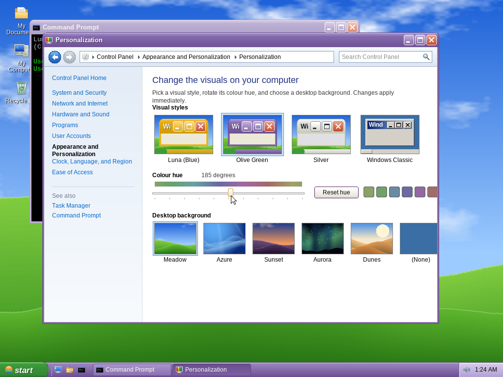
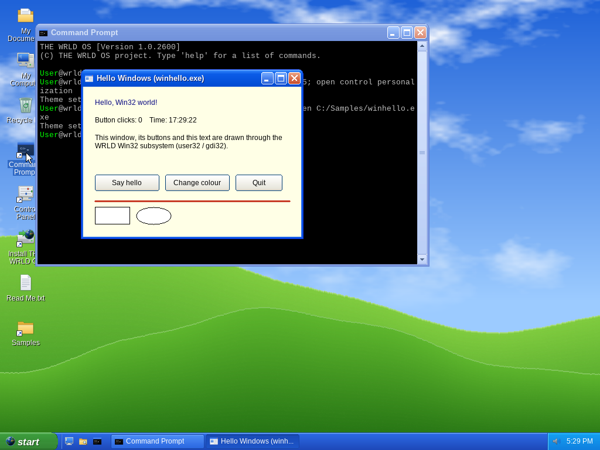
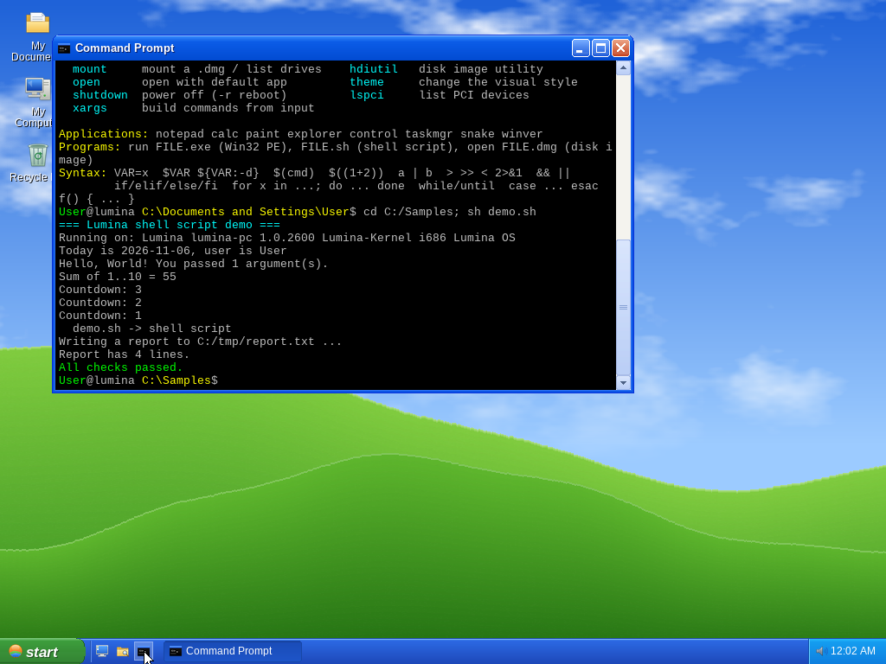
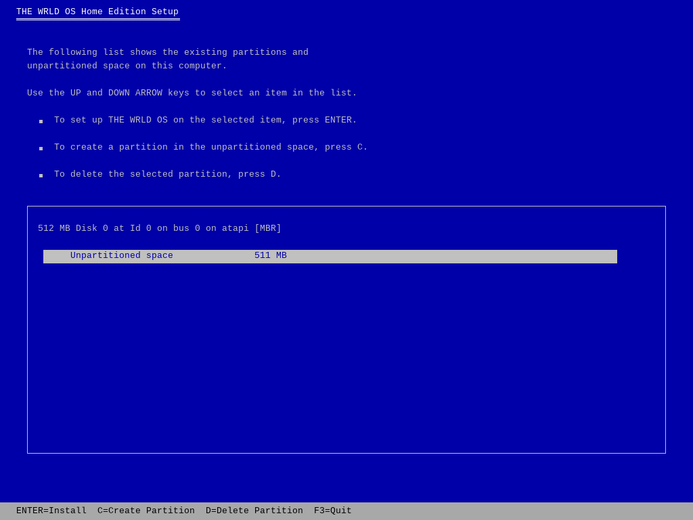
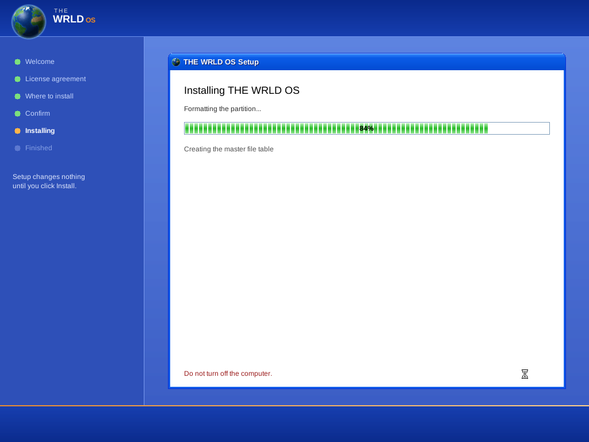
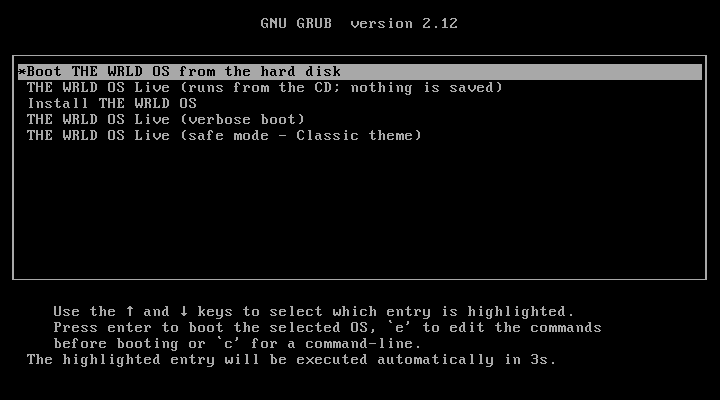
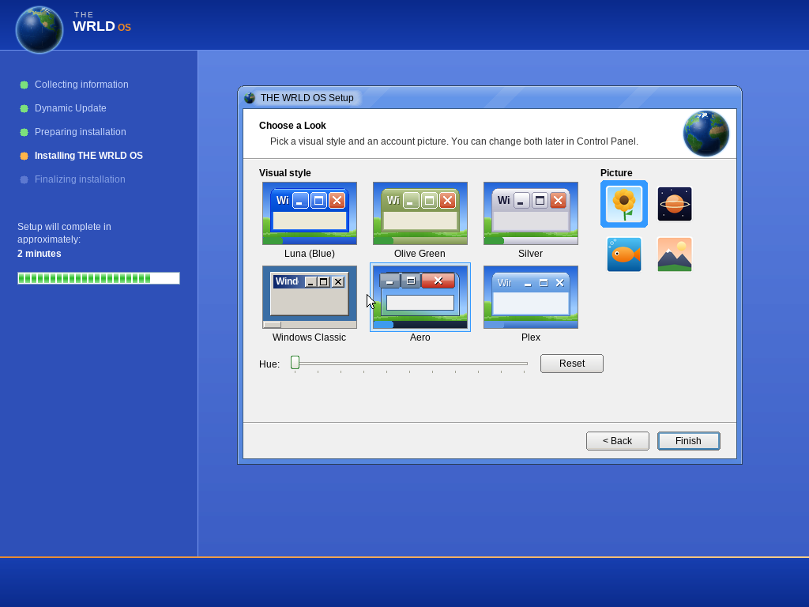

# THE WRLD OS

An original x86 operating system written from scratch in C and assembly (about 20,000
lines, plus the BearSSL library for HTTPS and the QuickJS JavaScript engine), in a **32-bit**
and a **64-bit (x86-64) edition**. It has an XP-style "Luna" desktop and a
category-style Control Panel, and it runs **Win32 `.exe` programs**, **`.sh` shell scripts** and opens
**Apple `.dmg` disk images**. It connects to the network and has its own web browser,
**The WRLD Xplorer**.

- Boots from a GRUB CD into a spinning-globe boot screen, a log-on screen and the desktop.
- **Two editions from the same sources:** `wrldos.iso` (32-bit, i686) runs 32-bit Win32
  programs; `wrldos64.iso` (64-bit, x86-64 long mode) runs 64-bit (x64) Win32 programs.
  Everything else is the same.
- Runs **live from the CD** or **installs to a hard disk** with an XP-style Setup, after which
  every file and setting is saved to the disk.
- Visual styles **Luna (Blue), Olive Green, Silver, WRLD Classic, Aero** (translucent
  blurred glass) and **Plex** (Longhorn-style). Each one is a `.wrldstyle` text file you can edit
  or copy, and each can be recoloured with **hue, saturation and lightness** sliders.
- **Networking:** an Intel PRO/1000 driver, a TCP/IP stack with DHCP and DNS, and HTTPS with
  certificate checking.
- **Real power-off** through ACPI, on VirtualBox, VMware, Hyper-V and real PCs as well as QEMU.
- **Sound:** drivers for Intel HD Audio, AC'97 (Intel, nVidia, AMD, SiS), Ensoniq AudioPCI
  (ES1370, ES1371/ES1373) and Sound Blaster 16. A startup sound plays when you log on and a
  shutdown sound plays before the computer turns off.
- **Graphics:** drivers for the Bochs/QEMU, VirtualBox and VMware display adapters, so the
  resolution can be changed at runtime (1024×768 up to 1920×1200 or more).


| | |
|---|---|
|  |  |
|  |  |
|  |  |
|  |  |
|  |  |
|  |  |
|  |  |

### The WRLD Xplorer

| | |
|---|---|
|  |  |
|  |  |

### Installing to a hard disk

| | |
|---|---|
|  |  |
|  |  |
|  |  |
|  |  |
|  |  |

## Quick start

### Windows: one double-click

Double-click **`Build to ISO.bat`** in the source folder. It:

1. builds through **WSL** (Windows Subsystem for Linux), or through **Docker Desktop** if WSL
   is not set up;
2. installs the Linux build tools on the first run (Ubuntu may ask for your Linux password);
3. writes **`wrldos.iso`** (32-bit edition) and **`wrldos64.iso`** (64-bit edition) next to
   the .bat file.

If neither WSL nor Docker is available, it explains why and offers to install WSL with Ubuntu.
After that you restart Windows, open *Ubuntu* once to create a Linux user, and run the .bat
again.

> MSYS2, MinGW and Cygwin cannot build the kernel. Their `gcc` makes Windows PE files, not the
> ELF kernel that GRUB loads, and they have no BIOS GRUB tools. `make` stops with an
> explanation if you try. The .bat file uses WSL for exactly this reason.

### Linux (or a WSL terminal)

```bash
sudo apt install build-essential gcc-multilib nasm grub-pc-bin grub-common xorriso mtools qemu-system-x86
```

```bash
make            # the 32-bit edition: build/wrld.elf and wrldos.iso
```

```bash
make ARCH=x86_64    # the 64-bit edition: build64/wrld.elf and wrldos64.iso (or "make both")
```

```bash
make run        # boots the CD in QEMU: live session, nothing is saved
```

`make ARCH=x86_64 run` (and `run-install`, `run-disk`) does the same with the 64-bit edition
in `qemu-system-x86_64`; its hard disk image is `disk64.img`.

Tested with Ubuntu 22.04 (gcc 11, binutils 2.38, GRUB 2.06) and 24.04 (gcc 13, binutils
2.42). `make check-tools` lists any missing tool. Fedora's `grub2-*` tool names are detected
automatically. On WSL, clone the repository inside the Linux file system (for example
`~/XPLikeTest`, not `/mnt/c/...`). On Windows 11 the QEMU window opens on the normal desktop.

## Running and installing

### In QEMU

| Command | What it does |
|---|---|
| `make run` | Live session from the CD. Nothing is saved. Networking uses QEMU's built-in NAT, and sound goes to PulseAudio/PipeWire when it's running (also under WSLg). |
| `make run-install` | CD plus a blank 512 MB `disk.img`. Choose **Install THE WRLD OS**. |
| `make run-disk` | Boots the installed `disk.img` on its own, with no CD. |
| `make disk` | Creates the blank `disk.img` (size: `make disk DISK_MB=1024`). |

You can also choose the emulated hardware:

- `make run SOUND=ac97` (or `ich9`, `es1370`, `sb16`) picks another emulated sound card
  instead of HD Audio.
- `make run VGA=vmware` uses the VMware SVGA II display adapter.
- `make run AUDIO=alsa` (or `sdl`, or `none`) picks QEMU's host sound output.

### In VirtualBox, VMware or on a real PC

Boot `wrldos.iso` (or `wrldos64.iso`, in a VM set up for a 64-bit guest, for example
VirtualBox's "Other/Unknown (64-bit)") with **legacy BIOS** boot (not UEFI) and at least
**64 MB RAM** (both editions start in 48 MB; 256 MB is comfortable for the browser). To install,
attach a hard disk on an **IDE** controller. SATA/AHCI, NVMe and USB disks are not supported.
For sound, any of the cards VirtualBox offers works (**Intel HD Audio**, **ICH AC97** or
**SoundBlaster 16**), and VMware's **HD Audio** or **Ensoniq AudioPCI** (ES1371). Graphics work with **VBoxVGA**, **VMSVGA** or
VMware's SVGA, and those can change resolution. For networking, use an **Intel PRO/1000** adapter. That's the default in VirtualBox ("Intel
PRO/1000 MT Desktop", NAT) and in QEMU, and usually in VMware (e1000).

While an installed system starts, the boot screen shows what it is doing, including
"Loading files from the hard disk… N%". If it stops on one step, that step names the device
involved. It also warns when the machine has less than 64 MB of memory.

If the desktop ever stops responding while the clock still runs, a red banner at the top of the
screen names the task that is busy (the same line goes to the serial log). Please include it
when you report the problem.

### The CD boot menu

| Entry | |
|---|---|
| **Boot THE WRLD OS from the hard disk** | Shown, and selected by default, once the system is installed. |
| **THE WRLD OS Live** | Runs from the CD in RAM (default when nothing is installed). |
| **Install THE WRLD OS** | Starts Setup. |
| Live (verbose boot) | Shows the kernel log on the boot screen. |
| Live (safe mode) | Starts with the WRLD Classic style. |

The installed system has its own boot menu with the same normal, verbose and safe-mode entries.

### What Setup does

You can also start Setup from the **Install THE WRLD OS** icon on the live desktop.

1. **Text-mode Setup** (blue screens, keyboard-driven, like XP's):
   - welcome screen and licence (F8 to agree);
   - **partition list**, where you can create (C) and delete (D) partitions;
   - **format** as FAT32, quick or full, or keep the existing FAT32 file system;
   - **copies the system** and writes the boot loader: GRUB's boot code in the MBR and its core
     image after the MBR;
   - restarts.
2. **First boot from the disk**: a graphical wizard asks for:
   - time zone;
   - your name and organisation;
   - computer name;
   - visual style and account picture.

   It then finishes with *Finalizing installation*.
3. From then on, changes to `C:` are written back to the disk: new folders, deletes and
   renames immediately, file contents within about 2 seconds and at shutdown/restart.
   Settings (theme, hue, wallpaper, account picture, user and computer name, time zone, mouse
   and clock options) are kept in `C:\WRLD\wrld.ini`. Control Panel > System and About show
   which disk and partition the system runs from, and how much space is free.

## Using THE WRLD OS

- **Samples** in `C:\Samples`:
  - `hello.exe`, a Win32 console program;
  - `winhello.exe`, a Win32 GUI program;
  - `demo.sh`, a shell script;
  - `Sample.dmg`, a disk image with a `.app` bundle and an installer script.
- **The WRLD Xplorer** (Start menu > Internet, or the globe on Quick Launch):
  - It runs **JavaScript** (QuickJS) and has a built-in **ad blocker**. Try
    `C:\Samples\JavaScript demo.html` (linked from the home page).
  - The home page links to sites that work well, such as Wikipedia, Hacker News, CNN Lite and
    68k.news.
  - It has DuckDuckGo search; you can also type words in the address bar to search.
  - `C:\Samples\Welcome.html` shows everything it can render.
- **Command Prompt** examples:
  - `ipconfig`, `ping example.com`, `nslookup example.com`;
  - `wget https://example.com/file.zip` downloads a file; `curl URL` prints it;
  - `theme list`, `theme aero`, `theme plex 200`, `theme saturation -40`, `theme lightness 20`;
  - `js -e "[1,2,3].map(x => x * x)"` or `js script.js` runs JavaScript;
  - `open control personalization` opens Control Panel at Personalization;
  - `open C:/Samples/Sample.dmg` mounts the disk image;
  - `hdiutil info` shows mounted images;
  - `sync` writes pending changes to the disk now (installed systems);
  - `display` lists screen resolutions, and `display 1280x800` switches to one;
  - `volume 60`, `volume mute`; `play "C:/WRLD/Media/WRLD Startup.wav"`;
  - `hostname`, `ps`, `free`, `shutdown -r`;
  - `help` lists all commands.
- **Keyboard**:
  - Win key opens the Start menu;
  - Alt+Tab switches windows and Alt+F4 closes them;
  - Ctrl+Shift+Esc opens Task Manager.

## What's inside

### 32-bit and 64-bit (`src/arch/i686`, `src/arch/x86_64`)
- One set of C sources builds both editions; only the boot stub, the interrupt and
  context-switch assembly and the linker script are per architecture.
- **x86-64:** GRUB loads the 64-bit ELF kernel through multiboot. A 32-bit stub checks for long
  mode, identity-maps the first 4 GiB with 2 MiB pages, enables PAE, long mode, the FPU and SSE,
  and calls the same `kmain`. Interrupt stubs save the SSE state (`FXSAVE`), so drivers and the
  JavaScript engine can use SSE; the cooperative context switch keeps the callee-saved
  registers.
- Win32 programs get their own address space: on x64 a private PML4/PDPT, with the image
  mapped at its preferred base (usually `0x140000000`) in 2 MiB pages, so no relocation is
  needed.

### Kernel (`src/kernel`)
- **CPU and interrupts:**
  - Multiboot entry with a VBE framebuffer request.
  - x86: GDT with a per-thread FS segment for the Win32 TEB; x64: the TEB through the GS base
    MSR. IDT and remapped PIC.
  - Exception handling: a faulting program is closed with an error dialog; kernel faults show
    a stop screen.
- **Memory:**
  - 4 MiB-page paging. Each Win32 process gets **its own page directory** for its image window
    (4–16 MiB), so several programs can load at the same base address.
  - Heap allocator.
- **Scheduling:** cooperative multitasking (tasks, sleep, kill, exit codes, CPU/idle
  accounting).
- **Devices:**
  - PIT timer (1 kHz), CMOS RTC, PS/2 keyboard and wheel mouse.
  - **Display (`video.c`):**
    - Bochs/BGA "DISPI" driver for QEMU's standard VGA, Bochs and VirtualBox VBoxVGA.
    - VMware SVGA II driver (command FIFO) for VMware and VirtualBox VMSVGA.
    - Resolution changes at runtime from Control Panel > Display, with an XP-style "keep these
      settings?" countdown, and are saved in `wrld.ini`.
  - **Sound (`audio.c`):**
    - **Intel HD Audio:** CORB/RIRB codec commands, and a search for the output path from the
      DAC to the speaker or headphone pins.
    - **AC'97:** bus-master DMA, for Intel ICH and the compatible nVidia nForce, AMD and SiS
      controllers.
    - **Ensoniq AudioPCI:** ES1370 (AK4531 codec) and ES1371/ES1373/CT5880 (AC'97 codec and
      the sample rate converter); DAC2 loops over the ring.
    - **Sound Blaster 16:** DSP 4.x, 16-bit stereo auto-init ISA DMA from a buffer below
      16 MiB; the 8237 count register gives the position.
    - Output is 48 kHz 16-bit stereo (44.1 kHz on the ES1370 and Sound Blaster 16), fed by a
      ring of DMA buffers refilled from the timer interrupt.
    - A 4-voice mixer with volume and mute, and a WAV loader for 8/16/24-bit PCM at any sample
      rate and channel count.
  - PCI enumeration, CPUID, PC speaker.
  - ACPI power management: reads the FADT and the DSDT's `\_S5_` soft-off value, so power-off
    works on any ACPI machine; restart uses the ACPI reset register, then port 0xCF9, then the
    keyboard controller.
  - Serial (COM1) kernel log.
- **Storage:**
  - ATA/IDE disk driver (polled PIO, LBA28/LBA48) and MBR partition tables.
  - **Read/write FAT32** driver: format, long file names, create/replace, recursive delete,
    rename/move, in-memory FAT with write-back.
  - Read-only FAT12/16/32 reader for disk images.
  - DEFLATE/zlib decompressor and UDIF `.dmg` parser.
- **Files:** in-memory VFS with drive letters, filled from a tar initrd (live CD) or from the
  system partition (installed). `persist.c` writes changes back to the disk and keeps the
  settings file.

### Networking (`src/net`)
- **Network card:** Intel PRO/1000 (e1000/e1000e) driver, polled.
- **Protocols:** Ethernet, ARP, IPv4, ICMP, UDP, DHCP client, and a DNS resolver (with
  `C:\WRLD\hosts`).
- **TCP:** client side, with MSS, a 64 KiB window, retransmission with back-off, and graceful
  close.
- **HTTPS (TLS 1.0–1.2):**
  - Built on [BearSSL](https://bearssl.org/) 0.6 (`third_party/bearssl`).
  - Certificates are checked against the 117 roots of the Mozilla root store (generated by
    `tools/gen_trust_anchors.py`), plus any `.crt`/`.pem` you put in
    `C:\WRLD\Certificates`.
  - The random generator is seeded from RDRAND and timing jitter.
- **HTTP/1.1 client:** GET and POST, redirects, chunked transfer, gzip/deflate.

### The WRLD Xplorer (`src/apps/browser.c`, `html.c`, `imgdec.c`)
- **HTML:** a forgiving parser with entities. UTF-8 and Windows-1252 are converted to Latin-1;
  other characters are replaced with close ASCII equivalents.
- **CSS:** simple selectors (tag, `.class`, `#id`) and `style` attributes, for colour,
  background, `display:none`, alignment, bold, italic, underline and size.
- **Layout:**
  - Text wrapping, headings, lists, blockquote, `pre` and `hr`.
  - Tables: column widths from min/max content, `colspan`, cell colours, borders, `valign`.
  - Images, form controls and in-page `#anchors`.
- **Forms:** text, password, checkbox, radio, select, textarea and submit, sent by GET or POST.
- **JavaScript** (`src/js`, `src/apps/dom.c`):
  - [QuickJS-ng](https://github.com/quickjs-ng/quickjs) 0.18 (`third_party/quickjs`), a
    complete modern JavaScript engine, built inside the kernel against a small C library and an
    x87 math library (`third_party/quickjs-shim`).
  - DOM: `document`, elements and text nodes, `getElementById`, `querySelector(All)` (CSS
    selectors with combinators, attributes and `:nth-child`), `innerHTML`/`outerHTML`,
    `textContent`, `createElement`, `appendChild`/`insertBefore`/`remove`, attributes,
    `classList`, `dataset`, `style`, form values, `document.write`.
  - Events with bubbling: `addEventListener`, `onclick` properties and attributes,
    `preventDefault`, click/input/change/keydown/submit, `DOMContentLoaded` and `load`.
  - `setTimeout`/`setInterval`/`requestAnimationFrame`, Promises, `localStorage`,
    `sessionStorage`, `document.cookie`, `fetch`, `XMLHttpRequest`, `location`, `history`,
    `navigator`, `alert`, `console`.
  - Inline and external scripts run in order before the first layout; each page then keeps a
    script task for events and timers. The page is laid out again whenever a script changes it.
  - Scripts that run long are interrupted regularly so the desktop stays responsive.
  - **Memory guard:** a page's memory (scripts, document, pictures) is counted. When it passes
    **500 MB**, the page is paused and you're asked whether to continue (asked again every
    further 500 MB) or stop it. Allocations are refused before the OS itself runs short.
  - Tools menu: Enable JavaScript, Script Messages (errors and `console` output).
- **Ad blocker** (`src/apps/adblock.c`):
  - Pictures, scripts and frames from about 140 ad and tracking servers, and ad-server URL
    paths, are never requested.
  - Elements whose class or id marks an ad slot (`ad-banner`, `adsbygoogle`, `div-gpt-ad-…`)
    are hidden.
  - Your own rules go in `C:\WRLD\adblock.txt`: host names (`||host^` also works), `##.class`
    and `###id` hiding rules, and `@@site` to allow a site.
  - The status bar shows how many items were blocked; Tools > Block Ads turns it off, Allow Ads
    on This Site adds an allow rule.
- **Images:**
  - PNG: all colour types, transparency and interlacing.
  - GIF: first frame, with transparency.
  - Baseline JPEG and BMP.
  - The Image Viewer uses the same decoders.
- **Window:**
  - Back/Forward/Stop/Refresh/Home, an address bar with a padlock for HTTPS, and a status bar.
  - Page source, Save Page, Favorites.
  - Error pages, `file://` folder listings, and downloads saved to `My Documents\Downloads`.

### Setup (`src/apps/setup.c`)
- **Text mode:** partition editor, FAT32 format (quick/full), file copy with progress, GRUB
  install.
- **First boot:** the graphical wizard. It runs before the log-on screen, using the normal
  widgets.

### Desktop (`src/gui`)
- **Rendering:**
  - Double-buffered framebuffer renderer (1024×768×32).
  - Anti-aliased Liberation fonts (SIL OFL).
  - 64 original, procedurally drawn icons (48/32/16 px) and five procedural wallpapers.
- **Branding:** a **globe logo** projected from a hand-drawn world map (`tools/globe.py`). It
  spins on the boot screen and is used for the Start button, About and Setup.
- **Window manager:**
  - Luna title bars with rounded corners and caption buttons.
  - Move/resize, maximize/minimize, double-click title, system menu.
  - Menu bars, popup menus, modal dialogs.
  - Alt+Tab, Alt+F4, Win key, Ctrl+Shift+Esc.
- **Shell:**
  - Taskbar with Start button, Quick Launch, task buttons and clock.
  - Two-column Luna Start menu with an All Programs flyout; Classic cascading Start menu with
    a vertical banner.
  - Tray balloons; desktop icons with context menus.
  - Boot screen, welcome screen, and Turn Off / Log Off dialogs over a desaturated desktop.
- **Visual styles**, all `.wrldstyle` files in `C:\WRLD\Resources\Themes`:
  - **Luna (Blue), Olive Green, Silver:** XP Luna.
  - **WRLD Classic:** also the built-in safe-mode fallback.
  - **Aero:**
    - Window frames are drawn on real **blurred, tinted glass**, with reflection streaks.
    - Title text glows; there's a wide red close button.
    - Glass taskbar, a glossy globe Start orb, and a glass Start menu.
  - **Plex:** after the Longhorn reference.
    - Glossy sky-blue title bars, bare caption glyphs, a blue taskbar.
    - Blue Start menu with round lock/power buttons.
  - **Hue (0–359°), saturation and lightness** sliders recolour any style; they are saved with
    your settings.
- **`.wrldstyle` format:** plain INI text.
  - `[Style]` holds `Name`, `Renderer` (luna, classic, aero or plex), `Description`, a
    suggested `Wallpaper`, and `Base` (inherit everything from another style).
  - It is followed by metrics (`title_h`, `border`, `taskbar_h`, …) and about 90 named colours.
  - Personalization's **Create a style...** writes a new file based on the current style and
    opens it in Notepad.
  - Double-clicking a `.wrldstyle` file anywhere installs and applies it.

### Applications (`src/apps`)
- **File Explorer:** task pane, Icons/Tiles/Details views, history, copy/cut/paste, rename,
  Recycle Bin, eject.
- **Notepad:** selection, clipboard, word wrap, Open/Save dialog.
- **Command Prompt.**
- **Control Panel (category style):**
  - Category / Large icons / Small icons views, breadcrumb bar, search, navigation pane.
  - 16 pages: Personalization, Display, Taskbar, Date and Time, System, Device Manager,
    Network, Mouse, Keyboard, Sound, Programs and Features, Default Programs, User Accounts,
    Fonts, Ease of Access.
- **Task Manager:** applications, processes, CPU/memory graphs.
- **The WRLD Xplorer** web browser (see above).
- **Others:** Calculator, Paint (BMP open/save), Image Viewer (PNG/JPEG/GIF/BMP), Snake,
  Properties, Run, About, Setup.

### Compatibility
- **`.exe`: Win32 subsystem (`src/win32`)**
  - PE loader: PE32 (x86) in the 32-bit edition, PE32+ (x64) in the 64-bit edition, with
    sections, base relocations (`HIGHLOW`, `DIR64`), import binding, TLS callbacks and the
    TEB/PEB of each architecture.
  - On x64 every exported function uses the Microsoft x64 calling convention (GCC's
    `ms_abi`), variadic ones (`printf`, `wsprintfA`) the matching `va_list`; handles,
    `WPARAM`/`LPARAM` and `*LongPtr` values are pointer-sized while `long` stays 32-bit (LLP64).
  - About 190 kernel32, 190 msvcrt, 160 user32 and 40 gdi32 functions, plus advapi32/shell32
    basics.
  - Console programs use the terminal for stdin/stdout.
  - GUI programs get real windows, message queues, timers, BUTTON/STATIC/EDIT/LISTBOX
    controls, menus, MessageBox and GDI drawing.
  - The samples are ordinary programs compiled with `i686-w64-mingw32-gcc` (32-bit edition,
    `rootfs/Samples`) and `x86_64-w64-mingw32-gcc` (64-bit edition, `rootfs64/Samples`) and run
    unmodified.
  - A program that calls an unimplemented function is stopped with a message naming it.
- **`.sh`: shell (`src/shell/sh.c`)**
  - Tokenizer and recursive-descent parser to an AST.
  - Variables, `${…}` operators, `$(…)`, backticks, `$((…))`, globbing.
  - Pipes, `>`, `>>`, `<`, `2>&1`, `&&`/`||`.
  - `if/elif/else`, `while/until`, `for`, `case`, functions.
  - About 70 built-in commands (`ls grep sort wc head tail find tree cp mv rm mkdir read
    printf test seq ps kill mount hdiutil open theme hostname shutdown …`).
- **`.dmg`: Apple disk images**
  - Reads the `koly` trailer, the XML plist `blkx` table and the `mish` chunk maps (raw,
    zero-fill, zlib/UDZO), then the MBR/GPT partition map.
  - The FAT volume inside is mounted as a new drive.
  - `.app` bundles launch through `Info.plist` → `CFBundleExecutable`; script executables run
    in the shell.

## Build targets

| Target | |
|---|---|
| `make` | Kernel and `wrldos.iso` (32-bit edition). |
| `make ARCH=x86_64` | Kernel and `wrldos64.iso` (64-bit edition); `make both` builds both. |
| `make run` / `run-install` / `run-disk` | See [Running and installing](#running-and-installing). |
| `make check-tools` | Lists missing build tools. |
| `make samples` | Rebuilds the Win32 samples (needs `gcc-mingw-w64-i686` and `gcc-mingw-w64-x86-64`). |
| `make dmg` | Rebuilds `rootfs/Samples/Sample.dmg` (needs `python3`, `dosfstools`). |
| `make assets` | Regenerates fonts, icons and the globe (needs Python with Pillow and NumPy, `fonts-liberation`). |
| `make clean` | Removes build output. |

`tools/qemu_harness.py` drives a headless QEMU over QMP (mouse, keyboard, screenshots). It was
used to test every screen above, including a full install from a blank disk.

## Limits

- **One program architecture per edition.** The 32-bit edition runs x86 programs and the
  64-bit edition runs x64 programs; each recognises the other kind and says which edition to
  use. .NET assemblies and 16-bit DOS programs are refused with an explanation. C++ exceptions
  in x64 programs (which need SEH unwinding) are not supported. Win32 coverage is a subset. Programs that use
  unimplemented APIs (COM, DirectX, dialog resources, networking, …) stop with a message naming
  the missing function.
- **macOS cannot be emulated.** Native Mach-O programs inside a `.dmg` are identified but not
  run; only script-based bundles work. HFS+/APFS volumes and bzip2/LZFSE/LZMA-compressed images
  are reported as unsupported. FAT volumes with raw or zlib chunks work.
- **Storage:**
  - The live CD runs from RAM.
  - An installed system keeps `C:` on a FAT32 partition of an **IDE/ATA** disk (bus-master DMA,
    with PIO as a fallback). SATA/AHCI controllers are not supported, so set the VM's disk
    controller to IDE.
  - At boot the whole partition is loaded into memory and changes are written back, so the
    installed system's size is limited by RAM.
  - BIOS/MBR only: no UEFI or GPT install.
- **Network and browser:**
  - Only Intel PRO/1000 cards, IPv4 only, and no Wi-Fi.
  - HTTPS uses TLS 1.2, so the few sites that only accept TLS 1.3 can't be opened.
  - JavaScript works for ordinary pages, but big web apps (which need layout-accurate CSS,
    canvas, modules or web workers) mostly won't.
  - It doesn't load external stylesheets or web fonts.
  - Unsupported images: WebP, SVG and progressive JPEG (the alt text is shown instead).
  - Text is limited to Latin-1; other scripts are replaced with `?`.
  - Text-heavy sites work best.
- **Hardware and design:**
  - No USB, and sound is playback only (no recording).
  - Resolution can only be changed on the display adapters listed above; otherwise it stays at
    GRUB's 1024×768. The minimum is 1024×768.
  - Single CPU. Both editions use memory below 4 GiB only (about 3.75 GB at most); the desktop
    itself needs about 16 MB.
  - Cooperative (not preemptive) scheduling, and programs run in ring 0.
- **Names and artwork:** "Luna", "Olive Green", "Silver", "Classic", "Aero" and "Plex" name the
  visual styles this project recreates. All artwork, icons, wallpapers and the globe logo are original.

## Project layout

```
Build to ISO.bat   one-click ISO build on Windows (WSL or Docker), both editions
src/arch           boot stub, interrupt/context-switch assembly, linker script: i686/, x86_64/
src/kernel         boot, cpu, ACPI, drivers, memory, scheduler, VFS, ATA, FAT32 (r/w),
                   FAT reader, inflate, DMG, persistence
src/net            e1000 driver, ARP/IP/ICMP/UDP/DHCP/DNS, TCP, TLS glue, HTTP, root certificates
src/gui            graphics, globe + wordmark, themes, window manager, widgets, desktop, screens
src/apps           explorer, notepad, terminal, control panel, accessories, launcher, setup,
                   browser (html.c, imgdec.c, dom.c, adblock.c)
src/js             JavaScript glue (engine.c) and the browser environment (prelude.js)
src/shell          sh interpreter
src/win32          PE loader, kernel32, msvcrt, user32/gdi32
src/include        headers (disk.h: disks/FAT32/setup; net.h: network stack)
third_party/bearssl  BearSSL 0.6 (TLS), MIT licence
third_party/quickjs  QuickJS-ng 0.18 (JavaScript), MIT licence
third_party/quickjs-shim  the small C and math library QuickJS is built against
samples/           Win32 sample sources (hello.c, winhello.c)
dmgroot/           contents of Sample.dmg
rootfs64/          files that replace rootfs/ ones in the 64-bit edition (x64 samples)
rootfs/            live C: drive (initrd), including WRLD/Resources/Themes/*.wrldstyle;
                   the build adds boot/ (kernel and GRUB images)
grub/grub.cfg      CD boot menu
tools/             asset/globe/trust-anchor generators, DMG builder, build-iso.sh, QEMU harness
docs/screenshots/  the screenshots in this README
```

## Credits and licences

- Fonts: [Liberation](https://github.com/liberationfonts/liberation-fonts) (SIL Open Font
  License).
- Boot loader: [GNU GRUB](https://www.gnu.org/software/grub/) (GPL v3). It is used on the CD,
  and Setup writes GRUB's boot images to the installed disk. Its source code is available from
  the GNU project.
- TLS: [BearSSL](https://bearssl.org/) 0.6 by Thomas Pornin (MIT licence), taken from the
  Debian/Ubuntu source package and built unmodified.
- JavaScript: [QuickJS-ng](https://github.com/quickjs-ng/quickjs) 0.18 by Fabrice Bellard,
  Charlie Gordon, Ben Noordhuis, Saúl Ibarra Corretgé and contributors (MIT licence), built
  unmodified; the licence text is at the top of each source file.
- Root certificates: the Mozilla CA certificate store, as shipped in Debian/Ubuntu's
  `ca-certificates` package.
- Everything else (kernel, drivers, network stack, browser, DOM, ad blocker, GUI, applications,
  Win32 subsystem, shell, artwork) was written for this project.
