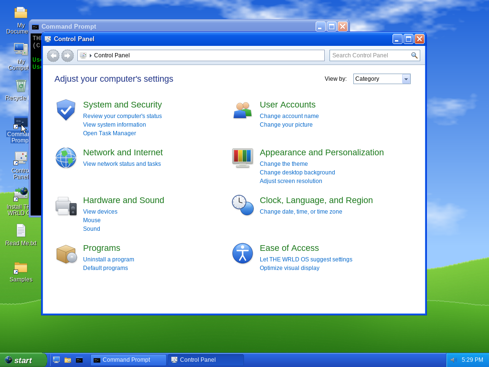
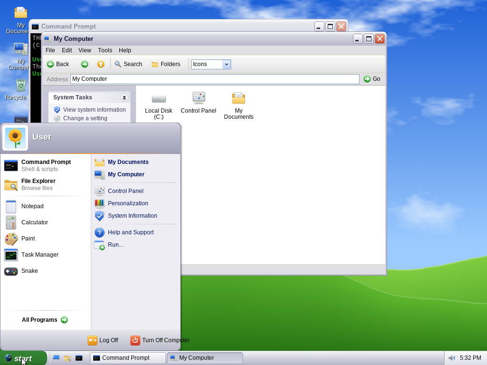
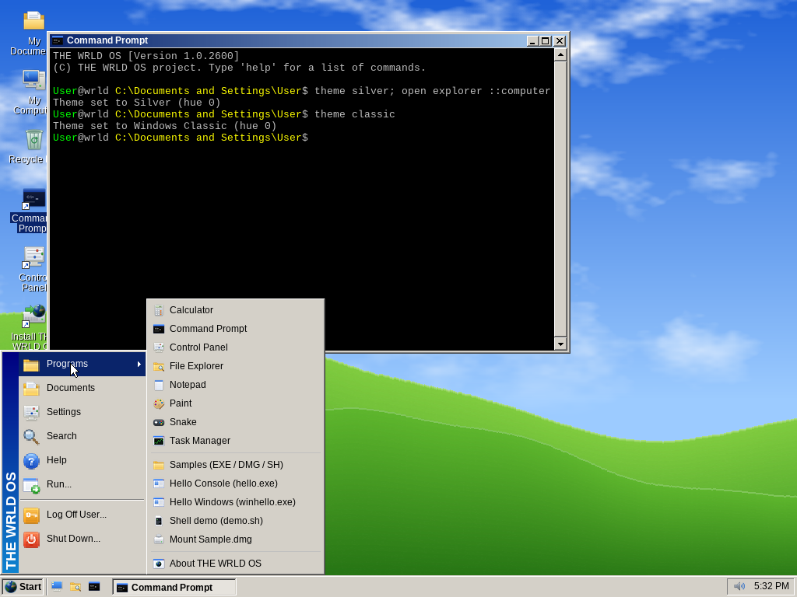
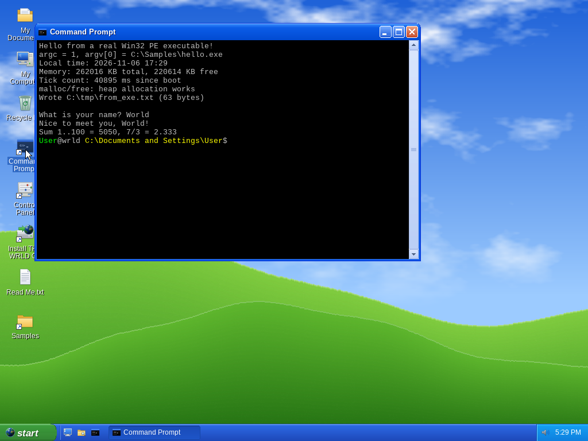
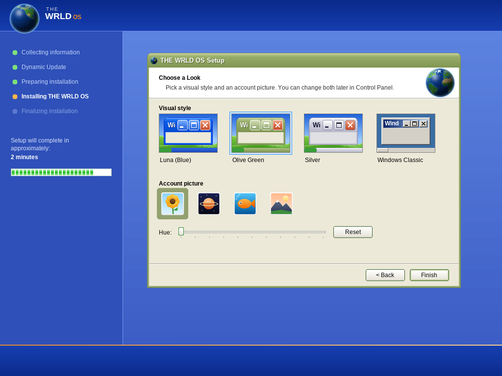
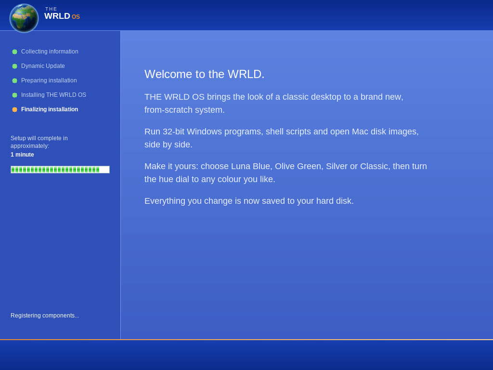

# THE WRLD OS

An original 32-bit x86 operating system written from scratch in C and assembly (about 14,000
lines). It has an XP-style "Luna" desktop and a Windows 7-style Control Panel, and it runs
**Win32 `.exe` programs**, **`.sh` shell scripts** and opens **Apple `.dmg` disk images**.

- Boots from a GRUB CD into a spinning-globe boot screen, a log-on screen and the desktop.
- Runs **live from the CD** or **installs to a hard disk** with an XP-style Setup, after which
  every file and setting is saved to the disk.
- Visual styles **Luna (Blue), Olive Green, Silver and Windows Classic**, each recolourable with
  a **hue slider**.


| | |
|---|---|
|  |  |
|  |  |
|  |  |
|  |  |
|  |  |

### Installing to a hard disk

| | |
|---|---|
|  |  |
|  |  |
|  |  |
|  |  |

## Quick start

### Windows: one double-click

Double-click **`Build to ISO.bat`** in the source folder. It:

1. builds through **WSL** (Windows Subsystem for Linux), or through **Docker Desktop** if WSL
   is not set up;
2. installs the Linux build tools on the first run (Ubuntu may ask for your Linux password);
3. writes **`wrldos.iso`** next to the .bat file.

If neither WSL nor Docker is available, it explains why and offers to install WSL with Ubuntu.
After that you restart Windows, open *Ubuntu* once to create a Linux user, and run the .bat
again.

> MSYS2, MinGW and Cygwin cannot build the kernel. Their `gcc` makes Windows PE files, not the
> 32-bit ELF kernel that GRUB loads, and they have no BIOS GRUB tools. `make` stops with an
> explanation if you try. The .bat file uses WSL for exactly this reason.

### Linux (or a WSL terminal)

```bash
sudo apt install build-essential gcc-multilib nasm grub-pc-bin grub-common xorriso mtools qemu-system-x86
```

```bash
make            # builds build/wrld.elf and wrldos.iso
```

```bash
make run        # boots the CD in QEMU: live session, nothing is saved
```

Tested with Ubuntu 22.04 (gcc 11, binutils 2.38, GRUB 2.06) and 24.04 (gcc 13, binutils
2.42). `make check-tools` lists any missing tool. Fedora's `grub2-*` tool names are detected
automatically. On WSL, clone the repository inside the Linux file system (for example
`~/XPLikeTest`, not `/mnt/c/...`). On Windows 11 the QEMU window opens on the normal desktop.

## Running and installing

### In QEMU

| Command | What it does |
|---|---|
| `make run` | Live session from the CD. Nothing is saved. |
| `make run-install` | CD plus a blank 512 MB `disk.img`. Choose **Install THE WRLD OS**. |
| `make run-disk` | Boots the installed `disk.img` on its own, with no CD. |
| `make disk` | Creates the blank `disk.img` (size: `make disk DISK_MB=1024`). |

### In VirtualBox, VMware or on a real PC

Boot `wrldos.iso` with **legacy BIOS** boot (not UEFI) and at least **256 MB RAM**. To install,
attach a hard disk on an **IDE** controller. SATA/AHCI, NVMe and USB disks are not supported.

### The CD boot menu

| Entry | |
|---|---|
| **Boot THE WRLD OS from the hard disk** | Shown, and selected by default, once the system is installed. |
| **THE WRLD OS Live** | Runs from the CD in RAM (default when nothing is installed). |
| **Install THE WRLD OS** | Starts Setup. |
| Live (verbose boot) | Shows the kernel log on the boot screen. |
| Live (safe mode) | Starts with the Windows Classic style. |

The installed system has its own boot menu with the same normal, verbose and safe-mode entries.

### What Setup does

You can also start Setup from the **Install THE WRLD OS** icon on the live desktop.

1. **Text-mode Setup** (blue screens, keyboard-driven, like XP's):
   - welcome screen and licence (F8 to agree);
   - **partition list**, where you can create (C) and delete (D) partitions;
   - **format** as FAT32, quick or full, or keep the existing FAT32 file system;
   - **copies the system** and writes the boot loader: GRUB's boot code in the MBR and its core
     image after the MBR;
   - restarts.
2. **First boot from the disk**: a graphical wizard asks for:
   - time zone;
   - your name and organisation;
   - computer name;
   - visual style and account picture.

   It then finishes with *Finalizing installation*.
3. From then on, changes to `C:` are written back to the disk: new folders, deletes and
   renames immediately, file contents within about 2 seconds and at shutdown/restart.
   Settings (theme, hue, wallpaper, account picture, user and computer name, time zone, mouse
   and clock options) are kept in `C:\Windows\wrld.ini`. Control Panel > System and About show
   which disk and partition the system runs from, and how much space is free.

## Using THE WRLD OS

- **Samples** in `C:\Samples`:
  - `hello.exe`, a Win32 console program;
  - `winhello.exe`, a Win32 GUI program;
  - `demo.sh`, a shell script;
  - `Sample.dmg`, a disk image with a `.app` bundle and an installer script.
- **Command Prompt** examples:
  - `open control personalization` opens Control Panel at Personalization;
  - `open C:/Samples/Sample.dmg` mounts the disk image;
  - `hdiutil info` shows mounted images;
  - `theme olive 185` sets Olive Green with a 185° hue;
  - `sync` writes pending changes to the disk now (installed systems);
  - `hostname`, `ps`, `free`, `shutdown -r`;
  - `help` lists all commands.
- **Keyboard**:
  - Win key opens the Start menu;
  - Alt+Tab switches windows and Alt+F4 closes them;
  - Ctrl+Shift+Esc opens Task Manager.

## What's inside

### Kernel (`src/kernel`)
- **CPU and interrupts:**
  - Multiboot entry with a VBE framebuffer request.
  - GDT with a per-thread FS segment for the Win32 TEB, IDT and remapped PIC.
  - Exception handling: a faulting program is closed with an error dialog; kernel faults show
    a stop screen.
- **Memory:**
  - 4 MiB-page paging. Each Win32 process gets **its own page directory** for its image window
    (4–16 MiB), so several programs can load at the same base address.
  - Heap allocator.
- **Scheduling:** cooperative multitasking (tasks, sleep, kill, exit codes, CPU/idle
  accounting).
- **Devices:**
  - PIT timer (1 kHz), CMOS RTC, PS/2 keyboard and wheel mouse.
  - PCI enumeration, CPUID, PC speaker.
  - ACPI/Bochs power-off and keyboard-controller reboot.
  - Serial (COM1) kernel log.
- **Storage:**
  - ATA/IDE disk driver (polled PIO, LBA28/LBA48) and MBR partition tables.
  - **Read/write FAT32** driver: format, long file names, create/replace, recursive delete,
    rename/move, in-memory FAT with write-back.
  - Read-only FAT12/16/32 reader for disk images.
  - DEFLATE/zlib decompressor and UDIF `.dmg` parser.
- **Files:** in-memory VFS with drive letters, filled from a tar initrd (live CD) or from the
  system partition (installed). `persist.c` writes changes back to the disk and keeps the
  settings file.

### Setup (`src/apps/setup.c`)
- **Text mode:** partition editor, FAT32 format (quick/full), file copy with progress, GRUB
  install.
- **First boot:** the graphical wizard. It runs before the log-on screen, using the normal
  widgets.

### Desktop (`src/gui`)
- **Rendering:**
  - Double-buffered framebuffer renderer (1024×768×32).
  - Anti-aliased Liberation fonts (SIL OFL).
  - 64 original, procedurally drawn icons (48/32/16 px) and five procedural wallpapers.
- **Branding:** a **globe logo** projected from a hand-drawn world map (`tools/globe.py`). It
  spins on the boot screen and is used for the Start button, About and Setup.
- **Window manager:**
  - Luna title bars with rounded corners and caption buttons.
  - Move/resize, maximize/minimize, double-click title, system menu.
  - Menu bars, popup menus, modal dialogs.
  - Alt+Tab, Alt+F4, Win key, Ctrl+Shift+Esc.
- **Shell:**
  - Taskbar with Start button, Quick Launch, task buttons and clock.
  - Two-column Luna Start menu with an All Programs flyout; Classic cascading Start menu with
    a vertical banner.
  - Tray balloons; desktop icons with context menus.
  - Boot screen, welcome screen, and Turn Off / Log Off dialogs over a desaturated desktop.
- **Visual styles:**
  - Luna (Blue), Olive Green, Silver and Windows Classic.
  - A **hue slider (0–359°)** recolours title bars, frames, taskbar, Start menu, selections and
    buttons in any style.

### Applications (`src/apps`)
- **File Explorer:** task pane, Icons/Tiles/Details views, history, copy/cut/paste, rename,
  Recycle Bin, eject.
- **Notepad:** selection, clipboard, word wrap, Open/Save dialog.
- **Command Prompt.**
- **Control Panel in Windows 7 style:**
  - Category / Large icons / Small icons views, breadcrumb bar, search, navigation pane.
  - 16 pages: Personalization, Display, Taskbar, Date and Time, System, Device Manager,
    Network, Mouse, Keyboard, Sound, Programs and Features, Default Programs, User Accounts,
    Fonts, Ease of Access.
- **Task Manager:** applications, processes, CPU/memory graphs.
- **Others:** Calculator, Paint (BMP open/save), Image Viewer, Snake, Properties, Run, About,
  Setup.

### Compatibility
- **`.exe`: Win32 subsystem (`src/win32`)**
  - PE32 loader: sections, base relocations, import binding, TLS callbacks, TEB/PEB.
  - About 190 kernel32, 190 msvcrt, 160 user32 and 40 gdi32 functions, plus advapi32/shell32
    basics.
  - Console programs use the terminal for stdin/stdout.
  - GUI programs get real windows, message queues, timers, BUTTON/STATIC/EDIT/LISTBOX
    controls, menus, MessageBox and GDI drawing.
  - The samples are ordinary programs compiled with `i686-w64-mingw32-gcc` and run unmodified.
  - A program that calls an unimplemented function is stopped with a message naming it.
- **`.sh`: shell (`src/shell/sh.c`)**
  - Tokenizer and recursive-descent parser to an AST.
  - Variables, `${…}` operators, `$(…)`, backticks, `$((…))`, globbing.
  - Pipes, `>`, `>>`, `<`, `2>&1`, `&&`/`||`.
  - `if/elif/else`, `while/until`, `for`, `case`, functions.
  - About 70 built-in commands (`ls grep sort wc head tail find tree cp mv rm mkdir read
    printf test seq ps kill mount hdiutil open theme hostname shutdown …`).
- **`.dmg`: Apple disk images**
  - Reads the `koly` trailer, the XML plist `blkx` table and the `mish` chunk maps (raw,
    zero-fill, zlib/UDZO), then the MBR/GPT partition map.
  - The FAT volume inside is mounted as a new drive.
  - `.app` bundles launch through `Info.plist` → `CFBundleExecutable`; script executables run
    in the shell.

## Build targets

| Target | |
|---|---|
| `make` | Kernel and `wrldos.iso`. |
| `make run` / `run-install` / `run-disk` | See [Running and installing](#running-and-installing). |
| `make check-tools` | Lists missing build tools. |
| `make samples` | Rebuilds the Win32 samples (needs `gcc-mingw-w64-i686`). |
| `make dmg` | Rebuilds `rootfs/Samples/Sample.dmg` (needs `python3`, `dosfstools`). |
| `make assets` | Regenerates fonts, icons and the globe (needs Python with Pillow and NumPy, `fonts-liberation`). |
| `make clean` | Removes build output. |

`tools/qemu_harness.py` drives a headless QEMU over QMP (mouse, keyboard, screenshots). It was
used to test every screen above, including a full install from a blank disk.

## Limits

- **32-bit only.** 64-bit (x64) `.exe` files, .NET assemblies and 16-bit DOS programs are
  detected and refused with an explanation. Win32 coverage is a subset. Programs that use
  unimplemented APIs (COM, DirectX, dialog resources, networking, …) stop with a message naming
  the missing function.
- **macOS cannot be emulated.** Native Mach-O programs inside a `.dmg` are identified but not
  run; only script-based bundles work. HFS+/APFS volumes and bzip2/LZFSE/LZMA-compressed images
  are reported as unsupported. FAT volumes with raw or zlib chunks work.
- **Storage:**
  - The live CD runs from RAM.
  - An installed system keeps `C:` on a FAT32 partition of an **IDE/ATA** disk (PIO mode).
  - At boot the whole partition is loaded into memory and changes are written back, so the
    installed system's size is limited by RAM.
  - BIOS/MBR only: no UEFI or GPT install.
- **Hardware and design:**
  - No network stack, USB or sound card (only the PC speaker).
  - Fixed 1024×768 resolution, single CPU.
  - Cooperative (not preemptive) scheduling, and programs run in ring 0.
- **Names and artwork:** "Luna", "Olive Green", "Silver" and "Classic" name the visual styles
  this project recreates. All artwork, icons, wallpapers and the globe logo are original.

## Project layout

```
Build to ISO.bat   one-click ISO build on Windows (WSL or Docker)
src/kernel         boot, cpu, drivers, memory, scheduler, VFS, ATA, FAT32 (r/w), FAT reader,
                   inflate, DMG, persistence
src/gui            graphics, globe + wordmark, themes, window manager, widgets, desktop, screens
src/apps           explorer, notepad, terminal, control panel, accessories, launcher, setup
src/shell          sh interpreter
src/win32          PE loader, kernel32, msvcrt, user32/gdi32
src/include        headers (disk.h: block devices, partitions, FAT32, persistence, setup)
samples/           Win32 sample sources (hello.c, winhello.c)
dmgroot/           contents of Sample.dmg
rootfs/            live C: drive (initrd); the build adds boot/ (kernel and GRUB images)
grub/grub.cfg      CD boot menu
tools/             asset and globe generators, DMG builder, build-iso.sh, QEMU test harness
docs/screenshots/  the screenshots in this README
```

## Credits and licences

- Fonts: [Liberation](https://github.com/liberationfonts/liberation-fonts) (SIL Open Font
  License).
- Boot loader: [GNU GRUB](https://www.gnu.org/software/grub/) (GPL v3). It is used on the CD,
  and Setup writes GRUB's boot images to the installed disk. Its source code is available from
  the GNU project.
- Everything else (kernel, drivers, GUI, applications, Win32 subsystem, shell, artwork) was
  written for this project.
